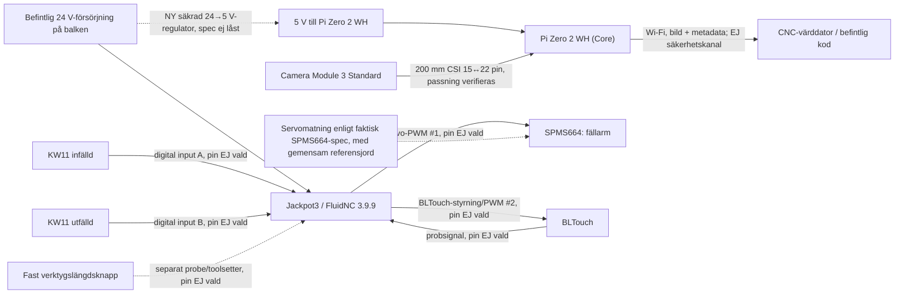

# Arkiv: tidigare byggstatus och sensorunderlag

**Historik, inte arbetsinstruktion eller aktuell status.** Versionerna nedan kommer från commit `46f1f6b` (2026-11-09), före konsolideringen 2026-11-10. De innehåller ersatta konstruktionsspår, gamla leveransuppgifter och inaktuella checklistor. Aktuell ingång är [README](../../README.md). Länkar inne i de citerade originalen behåller sina dåvarande sökvägar och är inte navigering i arkivet.

## Originalfil: `README.md`

~~~~~~markdown
# LowRider V4

Det här repot är single source of truth för den LowRider V4 som faktiskt byggs.

> **Läs detta först (2026-11-09):** De första avsnitten nedan är en **historisk bygg-/inköpssnapshot från september**, inte uppdaterad maskinstatus. LowRidern är **byggd och har fräst**, offerskivan planades senast 2026-10-22 och den permanent monterade mekaniken beskrivs i `BUILD_LOG.md`. Gällande **repo-konfiguration** pekas ut av `machine/AKTIV`; fysisk mätstatus finns i `CALIBRATION.md`, sensorbeställningar i `PROCUREMENT.md` och sensorernas design-/teststatus i `cnc/docs/PROJEKTJOURNAL_SENSORER.md`. **Z-nivå ännu inte verifierat färdig**, men squaring godkändes efter struts den 13 oktober (0,5 mm diagonalskillnad). Läs inte den äldre monteringsordningen som återstående arbete.

## Aktuellt läge — 2026-09-21

- Maskin: **LowRider V4**. PrintNC/IndyMill är inte aktiva alternativ.
- Arbetsyta: **650 × 1250 mm**.
- Geometri: rör **816 / 816 / 1505 mm**, Ø30×1,5 mm; strut-input **819 mm**; GT2 **999 / 1705 / 1705 mm**; minimum bord **941 × 1563 mm**; praktisk deck cirka **1000 × 1620 mm**.
- HaWiWe-order: **betald 1 853 kr och mottagen**, enligt användarens uppgifter. Ordervaluta 165,50 € inkl frakt. Innehåll: 6,0 mm XZ-plattor, 4 × MGN12H 150 mm, LR4 screw set och Makita/Elaire 1/8" collet.
- Controller: **Elecrow Jackpot3 `CQA240812C2` är mottagen**, faktisk debitering **937 kr** inklusive DDP Economy.
- Drive pulleys: **3 × GT2/2GT 16T / 5 mm bore / 10 mm belt är köpta via eBay/POWGE**, faktisk debitering **72 kr**, fri frakt och importavgifter inkluderade i eBay-köpet.
- LaskaKit-mekanikkärna: **mottagen**, 444 kr. Innehåll: 6 smooth idlers, T8×8 400 mm, 2 × 5→8-koppling och 5 m GT2 10 mm glasfiber. **4 × ersättnings-T8×8-mässingsmuttrar från Amazon är mottagna** (2 används + 2 reserv).
- Faktiskt betalt inklusive bordsskivan: **6 756,11 kr brutto**; **6 689,11 kr** exklusive 67 kr annullerad eBay-order som väntar återbetalning. Se `COSTS.md`.
- Mekanikinköp: grundmekaniken inklusive **3 × eBay/POWGE 16T-remhjul är mottagen**. Verifiera fysisk passning och antal mot beställningsspec innan montering. Köp inte T8-muttrar igen.
- Printer: **Bambu Lab P1S**; alla diameterberoende LR4-printar ska vara **30 mm-variant**, tool mount **Makita/65 mm**.
- Router: **KATSU 101750**, 710 W, cirka 65 mm; köpt.
- Filament: **3 kg PLA från PrintOnion** för 426 kr; utskrifterna är igång.
- Bord: **180×100 cm bordsskiva köpt för 300 kr**; ingen planerad 90 cm-kantbreddning, kontrollera underrede. Löstagbar ~12 mm MDF-spoilboard köps senare.
- Garagegrupp: **10 A**, praktiskt beprövad med svets; CNC är inte ett öppet elproblem om säkringen faktiskt håller.
- Dammhantering är del av grundbygget.
- **Maskinen körd 2026-10-04:** Jackpot3 (FluidNC 3.9.9, 192.168.50.184) styr maskinen; limits och homing fungerar. Kalibrering steg 1 (steps/mm **X 50,0835 / Y 50,2054**) och steg 2 (squaring, diagonalskillnad 1,6 mm; Y motor0 pulloff 6,2) är klara; steg 3 (Z-nivå) är uppskjutet till efter permanenta struts och planfräst offerskiva. Protokoll, mått och config-backuper: `CALIBRATION.md`, `machine/`. Squaring/Z-nivå görs om efter permanenta struts.
- Prints: användaren har rapporterat utskrift av **platta 14/14** samt att **hela Core är omprintad utan tidigare 0,20 mm förskjutning**. Den tidigare defekta Core används inte. **Det är inte bekräftat att det separata Makita/65 mm-verktygsfästet (eller Jackpot3-boxen) ingick i dessa plattor.** Se LR-00 och inventera utskrifterna före Core-montage.
- 3 × 16T-remhjul från eBay/POWGE: **mottagna 2026-09-21** enligt användaren; antal och tekniska mått kontrolleras under nästa inventering.
- Projektkostnad inklusive köpt bordsskiva: **6 756,11 kr brutto**, **6 689,11 kr** exklusive annullerad eBay-order på 67 kr som väntar återbetalning.

## Kanoniska filer

- `DECISIONS.md` — låsta beslut och explicita supersessions.
- `BOM.md` — exakt vad bygget behöver och vad som redan finns/köpts.
- `PROCUREMENT.md` — **enda kanoniska ordermatrisen** för kvarvarande köp.
- `COSTS.md` — **enda kanoniska kostnadsledgern**; faktiskt debiterade SEK-belopp.
- `CHECKLIST.md` — nästa arbete i fysisk ordning.
- `AUDIT.md` — mekaniska/elektriska/fysiska gates; innehåller inte flyktiga priser.
- `SOURCING.md` — daterad sourcing-evidens och länkar; ska inte duplicera en alternativ BOM.
- `TABLE.md` — bord/deck.
- `BUILD_LOG.md` — historik; gamla val får finnas här som historik men är inte current state.
- `WORK_ORDERS.md` — arbetskort om cirka en timme, med beroenden och återrapportering; lokal webbsidestatus är inte SSOT.
- `CALIBRATION.md` — kalibreringsprotokoll (steps/mm, squaring, Z-nivå) och enda mätloggen; baslinje-config i `machine/`.
- `CABLE_ROUTING.md` — kabellager, routing, mätprotokoll och verifierade kapmått (ännu tomma innan fysisk full-travel-kontroll).

## Monteringsguide

**Granskning 2026-09-29:** [resultat och öppna byggkontroller](AUDIT_2026-09-29.md). Rörgeometrin är omkontrollerad; T8 kräver provpassning före kap, kablar mäts en i taget och LR-22 ska godkännas före motorprov. Beräknade remlängder nedan skiljs från extra grovkapmarginal i manualen.

- [`docs/MONTERING_SV.md`](docs/MONTERING_SV.md) — svensk, utökad monteringsguide för den faktiska LR4-konfigurationen med **Jackpot3**. Läs tillsammans med V1E:s originalbilder; guiden ersätter inte kanoniska beslut eller checklistan.
- [Publicerad guide och arbetsordrar](https://kingkongola.github.io/lowrider/) — originalbilder inline, 30 entimmespass och kopierbar återrapport. Lokal status på webbplatsen synkas inte automatiskt med repot.
- `research/` — historisk evidens. Top-level-filerna ovan supersederar research vid konflikt.

## Sensorutbyggnad 2026-11-08

- [**Gemensam projektjournal**](https://github.com/kingkongola/cnc/blob/main/docs/PROJEKTJOURNAL_SENSORER.md) — historik, beslut, motiv, antaganden och nästa steg. Håll ingen kopia här.
- [Sensorarm: inkopplings- och provgrind](machine/delar/nollpunkt/INKOPPLING_OCH_PROV.md) — dokumenterad kontroll före **eventuell** inkoppling; inga steg fysiskt verifierade.
Enligt användaren är kamera, mikrofoner, accelerometer och BLTouch nu **beställda, ej mottagna**. [Orderstatus och obekräftade exakta orderrader](PROCUREMENT.md); [mjukvaruarkitektur och kodstart i cnc](https://github.com/kingkongola/cnc/blob/main/docs/sensorarkitektur.md). Sensorfunktionerna är inte monterade eller driftsatta.

## Pågående experiment och automationsidéer

- [Automatisering och kamera – idéer 2026-11-06](docs/AUTOMATISERING_OCH_KAMERA_2026-11-06.md): krav på kamerasystemet, Tapo/Coral, BLTouch på servoarm, vakuumfastspänning, Genie-frammatning/indexering, billig verktygsväxling och manuell tvåsidig registrering. **Forsknings- och provplan, inga låsta konstruktionsbeslut.**

## Aktuell arbetsordning

1. Inventera utskrivna LR4-delar. **Kontrollera explicit om det separat nedladdade Makita 701/65 mm-verktygsfästet finns; vid frånvaro skriv ut det enligt LR-00.** Verifiera även 30 mm-varianter, rätt Jackpot3-box och **4 × temporära struts (15 % infill)**. Platta 14/14 innebär inte att separat mount-set automatiskt ingick.
2. Kontrollera köpta 180×100-skivans underrede/styvhet och provlägg rail/belt-layout. Mät/kapa rör efter OD-/rakhetskontroll.
3. Inventera HaWiWe, DigiKey, remhjul och el-/kabeldelar mot BOM. Alla tre beställda 16T-remhjul är mottagna; kontrollera tänder/hål/rembredd före montering.
4. Köp/ordna ~12 mm MDF-spoilboard, 5–6 mm strutmaterial, första 3,175 mm-fräs samt NVR/kapsling efter fysisk dry-fit.
5. Montera maskinen med temporära struts, konfigurera Jackpot3, torrkör och fräs permanenta struts (`819`, `front_wing_size=10.8`) med maskinen själv.
6. Byt till permanenta struts, gör full-travel-test för kablar/slang, färdigställ dammhantering och planfräs offerskivan.

Bred komponentresearch ska inte återöppnas utan ett konkret pris-, lager-, kompatibilitets- eller integrationsproblem.
~~~~~~

## Originalfil: `CHECKLIST.md`

~~~~~~markdown
# Checklist

## 1. Beställningar — nu

- [x] LaskaKit mekanikkärna — köpt 2026-09-03 för **444 kr faktiskt debiterat**
- [x] 4 × **T8×8 brass nut, 2 mm pitch / 4-start / 8 mm lead** — Amazon.se/euroharry, **101,76 kr visat orderpris**, **mottaget 2026-09-10**
- [x] 3 × GT2/2GT drive pulley **16T / 5 mm bore / 10 mm belt / 2 mm pitch** — eBay/POWGE, **72 kr**
- [x] DigiKey — PSU, endstops, 608-lager, Wago, glands, Faston, kablage och pigtails, **986,98 kr**; **mottaget/hämtat 2026-09-09**
- [x] 5 × STEPPERONLINE `17HS19-2004S1` — Amazon.se, **608,37 kr visat orderpris**
- [x] Elecrow Jackpot3 `CQA240812C2` — **937 kr**
- [x] KATSU `101750` router — Amazon.se, **620,00 kr visat orderpris**
- [x] **3 kg PLA 1,75 mm från PrintOnion** — **426 kr**
- [x] **2 × Motonet-rör** — köpt 2026-09-07 för **340 kr totalt**; planerad spec Ø30×1,5×2000 mm

**Kärnmekanik, elektronik, router, filament och rör är köpta/beställda. Alla 3 × 16T-remhjul är mottagna 2026-09-21; kontrollera fysisk specifikation vid inventering.**

## 2. Lokalt / fysiskt

- [ ] räkna av DigiKey-paketets innehåll mot BOM före montering
- [ ] verifiera de köpta Motonet-rörens faktiska OD/rakhet/längd före kapning
- [ ] kapa rör först därefter: 1505 / 816 / 816
- [x] **180×100 cm bordsskiva köpt för 300 kr**, rapporterat 2026-09-19
- [ ] kontrollera underredets styvhet, höjd och infästning; ordna eventuell förstärkning bara vid behov
- [ ] markera 941×1563 mm footprint på den köpta skivan och kontrollera rail/belt-zoner; **ingen 90 cm-kantbreddning behövs**
- [x] 3 × 16T-remhjul från eBay/POWGE mottagna 2026-09-21
- [ ] kontrollera 16T, 5 mm hål och kompatibilitet med 10 mm GT2-rem före montering

## 3. När HaWiWe anländer

- [ ] kontrollera transportskada
- [ ] kontrollera fyra produktgrupper: XZ-plattor, 4 rails, screw set, collet
- [ ] provmontera M3×10 mot 6,0 mm XZ/MGN-block; inget bottnar/binder

## 4. Prints

- [ ] hämta senaste LR4-filer
- [ ] verifiera **30 mm** på alla railberoende delar
- [ ] **kontrollera om Makita/65 mm-verktygsfäste verkligen är utskrivet**. Det ingår inte bekräftat i våra 14 MakerWorld-plattor; V1E listar det som separat [Makita 701 Tool Mount and Dust Shoe](https://www.printables.com/model/1033926-makita-701-tool-mount-and-dust-shoe-for-the-lowrid).
- [ ] om fästet saknas: välj rätt 65 mm-variant för KATSU 101750; slic:a och skriv ut enligt modellbeskrivningen (V1E:s deltabell anger 30 % infill); kontrollera passning före Core LR-07. Se arbetsorder LR-00.
- [ ] kontrollera separat om **Jackpot3 board box** är utskriven (V1E länkar till en separat modell); anta inte att den följer med grundplattorna.
- [ ] provprinta `Z_Stub` + `Z_Nut`
- [ ] kontrollera passning; **Core är helt omprintad utan den rapporterade 0,20 mm förskjutningen** — denna felanmärkning gäller inte den nya Core
- [ ] granska slicer bridges/unsupported geometry
- [ ] inventera utskrifterna efter att användaren rapporterat platta 14/14: grundplattornas status, separat tool mount, Jackpot3-box och temporära struts verifieras var för sig.
- [ ] printa **4 × temporära struts, 15 % infill** för första monteringen
- [x] **monterade 2026-10-22 enligt användaren.** generera permanenta front-/bottenstruts med `strut_length=819`, `front_wing_size=10.8` (5–6 mm MDF/hardboard, max 6,35 mm); fräs med färdigmonterad LR4 och byt sedan ut temp-struts

## 5. Bord / spoilboard

- [ ] använd den köpta **180×100 cm** bordsskivan direkt som strukturell maskinbas, förutsatt godkänt underrede
- [ ] köp **inte** hel OSB/ply-deck om inte verkligt behov uppstår
- [ ] planera rail/belt-infästning på 180×100-skivan, utan tidigare planerad 90 cm-kantbreddning
- [x] offerskiva fastskruvad, rapporterat 2026-10-07 (material/tjocklek ej rapporterat; inte planfräst)
- [x] offerskivan planfräst (`plan07`, 0,7 mm), rapporterad plan 2026-10-22
- [ ] inget T-track före faktiskt behov

## 6. Mekanik

- [ ] montera gantry/Y/Z
- [ ] provpassa T8 på båda YZ-sidorna före kapning enligt manualens kapitel 0; 150 mm är provmått, D014:s 150–160 mm är inte automatiskt godkänt
- [ ] kontrollera lätt Z-rörelse utan binding
- [ ] kontrollera hela 5 m-rullens fördelning före första klippet: V1E beräknat 999 / 1705 / 1705 mm; vår extra grovkapmarginal ger minst 1029 / 1735 / 1735 mm. Trä remmar i LR-08/09/10; slutspänn efter LR-16
- [ ] montera 16T/rem/idlers
- [ ] montera KATSU `101750` i Makita/65 mm mount
- [ ] provpassa Elaire-collet
- [ ] kontrollera runout
- [ ] kontrollera fri manuell rörelse över hela slaget
- [ ] squara maskinen

## 7. Damm

- [ ] bekräfta DeWalt-typskylt
- [x] printa LR4 dust shoe (dammsugning monterad 2026-10-22 enligt användaren)
- [ ] prova befintlig TPU till bristles
- [ ] printa cyklon: **eifelbiker "Cyklonseparator med undertrycksventil"** (MakerWorld, `Zyklon.3mf`), P1S-profil, PLA, 3–4 väggar, ~18,7 h; TPU-packningar (separat profil, 1,7 h); egna 46 mm-stosar mot slangen; ventilens fjäder 0,5×6×20 mm + M3x25/M4x35 + mutterinsatser M3/M5 behövs. Utskrift påbörjad 2026-10-16 (användarens rapport); ej verifierad klar.
- [ ] ordna 15–30 l styv behållare
- [ ] vakuumtesta behållare/lock kontrollerat
- [x] **Slang finns redan:** 4 meter poolslang, ID 46 mm (uppmätt 2026-10-14); användaren har använt den med DeWalt för att rengöra FTX-kanalerna. Inget nytt slanginköp behövs i nuläget. DeWalt-originalslang är för kort.
- [ ] **Anpassa och verifiera sugslang på LowRider:** dammsugaren monterad 2026-10-22 enligt användaren; slangmått mätt (ID 46 mm) och adapter till Makita-dammskon printad (`slangadapter_46mm`, cnc-repot); kvar: ordna upphängning/dragavlastning och prova full X/Y/Z-rörelse. Beakta att vanlig poolslang normalt inte är antistatisk.
- [ ] bygg slangavlastning
- [ ] lös statisk jordväg före XPS/reguljär MDF/trä-drift

## 8. Controller/lågspänning

- [ ] inventera data-USB-C
- [ ] inventera FAT32 microSD >2 GB
- [ ] när Jackpot3 anländer: kontrollera transportskada/korrekt kort
- [ ] montera Jackpot3 luftigt på rörlig beam/YZ_Min-sida
- [ ] provplacera även HDR-60-24 på balken; verifiera skyddad 230 V-anslutning, kapsling, DIN-infästning, ventilation och dragavlastning innan anslutning; HDR är klass II utan PE-plint
- [ ] flasha V1E:s då aktuellt testade FluidNC + rätt LR4-config
- [ ] koppla motorer
- [ ] första jogg 1 mm först efter godkänd nätmatning/stopp (LR-22), kabeldragning och brytarprov
- [ ] **LR-08: BEKRÄFTAT PASSNINGSFEL:** köpta 3×26 AWG-kabelns cirka Ø4 mm mantel går inte genom Core. **Tvinga inte in den.** Prova individuellt isolerade innerledare enbart genom tunneln med oskadad isolering, avlastad mantel utanför och skavskydd; alternativt tunnare flexibel tvåledarkabel/skyddad yttre dragning. Kontrollera även YZ-kanalernas passning. Förbered med märkt dragtråd om kabelvägen ännu inte är mätbar; vid LR-16 mäts och kapas en brytarkabel i taget från rullen. **250 cm är inte verifierat kapmått.** LR-16: kontrollera full rörelse och kapa först efter faktisk dragning.
- [ ] koppla 5 endstops NC via COM+NC
- [ ] verifiera varje endstopstatus

## 9. NVR/elbox + full travel

- [ ] välj NVR efter faktisk variant/schema; Clas Ohlson KJD12 230 V/10 A är aktiv kandidat
- [ ] dry-fit fast NVR och balkmonterat HDR-60-24 med separat beröringsskydd; bestäm kapsling och håltagning först efter fysisk kontroll
- [ ] placera stoppet direkt nåbart
- [ ] dry-fit kort 24 V-rutt mellan balkmonterat HDR-60-24 och Jackpot3; den köpta 3 m-kabeln är reserv, inte obligatorisk rörlig slinga
- [ ] dry-fit säker nätmatning till balkmonterat HDR-60-24
- [ ] dry-fit KATSU-kabel
- [ ] dry-fit motor/endstop
- [ ] montera vac-hose samtidigt
- [ ] kör manuellt alla fyra hörn + Z-extremer
- [ ] slutlig dragavlastning först efter godkänt full-travel-test

## 10. 230 V verifiering

- [ ] följ exakt terminalschema
- [ ] PE kontinuerlig/oswitchad
- [ ] kontrollera kabel-OD mot glands
- [ ] inga åtkomliga live-delar med boxen stängd
- [ ] kontinuitetstesta PE
- [ ] verifiera ingen L/N→PE-kortslutning
- [ ] verifiera NVR/no-restart med router frånkopplad

## 11. Driftsättning

- [ ] torrkör utan fräs
- [ ] verifiera full driven travel
- [x] kalibrering steg 1 (steps/mm) och 2 (squaring) enligt CALIBRATION.md, 2026-10-04
- [ ] kalibrering steg 3 (Z-nivå) efter permanenta struts (klart 2026-10-22) + planfräst offerskiva; gör om squaring då
- [ ] plana spoilboard
- [ ] kontrollera X/Y-mått + diagonaler
- [ ] kontrollera Z-djup
- [ ] fräs kalibreringsbit
- [ ] spara fungerande config-backup
- [ ] första enkla jobb i billigt material

## Senare — inte nu

- [ ] hel deck/torsionsbox endast om det faktiska bordet visar att det behövs
- [ ] Sorotec/extra fräsorder när första verkliga fräsbehoven är kända
- [ ] router-/stepperförlängning endast om dry-fit kräver
- [ ] T-track/insert-grid/vacuum-table efter erfarenhet
- [ ] laser tidigast 2027
- [ ] plasma utanför detta bygge
~~~~~~

## Originalfil: `machine/delar/sensorer/README.md`

~~~~~~markdown
# Sensorenhet till V1E LowRider V4 – build123d

**Status 2026-11-09:** parametrisk, separat demonterbar **sensortillsats på befintlig Core/verktygshållare**. Det här är INTE själva V1E-Core och inga originaldelar ändras. Nya delar utgår från [befintlig build123d-servoarm C](../nollpunkt/fallarm_c.py), men den gamla cylindriska proben är **ersatt av BLTouch-geometri i konceptet**. Ingen maskin-CAD är fysiskt validerad.

**Gällande kod:** [core_enhet.py](core_enhet.py). **[Senaste gröna GitHub-CI och levererad STL/STEP/GLB](https://github.com/kingkongola/lowrider/actions/workflows/core-build123d.yml)**. Äldre [core_sensorer_v0.scad](core_sensorer_v0.scad) är **ersatt/legacy** och ska **inte** användas för nya utskrifter, trots att äldre test-STL-filer kan finnas i historik. CAD medges inte bara för att trianguleringen lyckas.

## Monteringsprincip: en enhet, elva unika CAD-delar (12 utskrifter)

| Del | Roll | Byt utan att demontera |
| --- | --- | --- |
| `rygg` | Bärande platta; nyttjar **två befintliga M5 på verktygsfästet**, samma koordinater som arm C | Ingen original-Core behöver modifieras |
| `kabellock` | Skruvat, avtagbart lock över **6×3 mm** kabelspår och tre serviceutgångar | Servo, kamera och Pi |
| `servokassett` | Separat demonterbar ram för SPMS664 | Kamera, Pi, rygg |
| `bltouch_arm` | Separat utbytbar arm för lodrät BLTouch vid mätning | Kamerakassett/Pi |
| `kw11_hallare` (2 ×) | **Två likadana justerbara hållare** på servokassettens egna fästöglor; två lägesgivare men en CAD-fil | Kamera, Pi och övriga maskinen |
| `kamerakassett` | Egen triangulerad, styv infästning med M2-hålbild **21×12,5 mm** | Servokassett/Pi |
| `pi_lada` | Utbytbar, fläktlös kapsling för Pi Zero 2 WH, **58×23 mm M2.5** | Kamera/servo; dockan sitter kvar |
| `pi_lock` | Avtagbart lock för Pi; inga snäpphakar | Rygg och kamera |
| `pi_dock` | Egen hållare mellan bärplattan och Pi-kapslingens fästöglor | Servo/kamera |
| `accel_bricka` | Småskruvad, styvt kopplad ADXL345-bärare med distanser bort från kabelkåpan | Andra sensorer |
| `mikrofon_bricka` | Egen M2.5-skruvad INMP441-pod på **Pi-lådans utsida**, akustiskt hål | Pi-kortet kan sitta kvar; hela lådan får dock tas loss vid lådbyte |

**Konstruktionsregel:** kamera och dess fäste får inte flytta sig när servot demonteras. Inget är limmat eller ihopgjutet mellan funktionerna. Bärplattan använder två hål ur befintlig C-modell: M5-centra Y43,95 / Z64,25 respektive Y43,95 / Z125,25 i projektets *M-ram*; **inte nytt borrmönster på den riktiga Core-delen**. Huvudkabelkanalen är öppningsbar medan maskinankarna sitter kvar. Servons flexkabel kräver separat, ännu inte uppmätt serviceslinga.

## Vad som är verifierat med kod

[GitHub Actions: Modular Core-enhet (build123d)](https://github.com/kingkongola/lowrider/actions/workflows/core-build123d.yml) använder build123d 0.10.0 och kompatibelt OCP, exporterar 11 × STL + 11 × STEP. Den testar:
- alla 11 STL är **slutna vattentäta sammanhängande mesh-kroppar** med positiv volym;
- de tolv fysiska delarna i monteringsmodellen har **inga volumetriska BRep-överträdelser mot varandra** i monterade lägen;
- en **BLTouch-body-attrapp + arm** sveps över 0 till −90° i **15°-steg** och kontrolleras mot våra andra CAD-moduler och ritad SPMS664; inga BRep-skärningar i provsvepet;
- Core, Makita-tool mounts, dammsko, dammskokjol och SPMS664-kropp i befintliga STL refereras. **Ytavstånd till dessa är endast sampling/screening**, inte en exakt mesh-kollisionskontroll. Rapport i `montage-granskning.json`.
- **Sensorenhet-på-Core.glb** genereras som interaktiv färgkodad 3D-scen med separata objekt. Även `core-koncept.png` finns i artefakten.

**VIKTIGT: Detta är CAD-validering, inte driftsäker eller industrimässigt färdig konstruktion.** Monteringshålen från gamla C-versionen måste kontrolleras på faktisk maskin. De faktiska Core-/verktygsfäste-STL är referensgeometri; gamla transformen från [kontroll_c.py](../nollpunkt/kontroll_c.py) används och behöver kontrolleras mot verkligt montage. Ordet ”passar” får inte hävdas utifrån dessa tester.

## Kända P0-kvarstår innan BLTouch-armen får printas för drift

1. **Två separata hårda mekaniska stopp** (utfällt och infällt), samt korrekt aktivering av **2 × QUARKZMAN KW11-3Z-N**. De två justerbara små brytarfästena är nu ritade och har klarat CAD-kontroll mot våra delar. **Rullspakens aktiveringspunkter, motgående kammar och hårdstoppen är ännu INTE konstruerade eller verifierade.** Brytarna får aldrig bära stoppkraften. Se [ANDLAGEN.md](../nollpunkt/ANDLAGEN.md). `Omron SS-3GL13PT` behålls till original-LowRidern.
2. Fysiskt **servohorn i metall**, faktisk servosplines, BLTouch-infästningsskruvar, 3D-printtoleranser och kabeldragning på rörliga armen ingår **inte** i det gröna svepet. Tidigare C-version hade cirka 1 mm frigång till servo och 3,4 mm till dammskokjol enligt annan modell. De värdena är inte giltiga för den nya.
3. **BLTouch** i koden använder preliminärt 18 mm hålavstånd, 36,3 mm kropp och **45,7 mm till utfälld stiftspets** enligt tillverkarritning. Faktisk BLTouch-version och dess skruvskallar, utsticket för in-/utfällt stift, kroppens kontakt/hus och hela probe-kabeln måste mätas och modelleras. Proben får inte träffa fräs, dammsko, golv, offerskiva eller sig själv i något läge.
4. Kamerans **200 mm CSI-flex** får inte vikas/skavas eller vara sträckt vid service. Rita fysisk port-/snäpporientering och dragavlastning när delarna är på plats. Pi-kapslingen har kabelöppning och är **inte spåntät/IP-klassad**. Nätaggregatregulator, skydd, elkoppling och GPIO fastställs separat i [KOPPLING_CORE_V0.md](KOPPLING_CORE_V0.md).
5. Kontroll av **verklig filmaskin, dammskokjol, all Z-position**, och framför allt hur monteringsskruvarna nås när systemet sitter på Core. Utskriftsorientering, stödstrukturer, skruvtyp/längd, insatser och printmaterial är inte slutligt validerade.

## Nytt 2026-11-09: två identiska, justerbara KW11-hållare

- **Köpt:** 10 × QUARKZMAN KW11-3Z-N från Amazon.se för 92,94 kr med fri Prime-frakt; beräknad leverans **lördag 2026-11-14**. Se [PROCUREMENT.md](../../../PROCUREMENT.md). Beställda, inte mottagna.
- **CAD som kod:** [kw11_faste.py](kw11_faste.py), en fasad hållare med **två M2-långhål** för osäker KW11-hålbild **8,5–9,5 mm**, och två M3-långhål med cirka ±2 mm finjustering. **Antal utskrifter: 2 × `kw11_hallare.stl`.** Den befintliga **servokassetten** har fått två korta monteringsöron; inga nya hål på V1E Core eller på kamera-/Pi-delarna. Hållarna kan bytas utan att flytta kameran.
- **CAD-grind:** [grön GitHub Actions-körning](https://github.com/kingkongola/lowrider/actions/runs/42616662416) gav 11 separata STL + 11 STEP och BRep utan modellöverlapp för de 2 hållarna, övriga moduler och förenklat BLTouch-svep. Detta testar **inte** brytarnas faktiska hus, rullspak, klickväg, ledaranslutningar eller de ännu saknade hårdstoppen. De nya fästena är **mått-/passningsprototyper**, inte driftsklara ändlägen.
- **Provrutin efter leverans:** mät kropp, hålavstånd, pinnarnas läge och spakens verkliga tillslags-/återgångsväg. Skruva fast en lös brytare i en lös printad hållare först. Ta reda på hur två åtskilda mekaniska stopp ska byggas så att brytarna bara läser läget; använd aldrig brytarspaken som stopp.

### KW11-mått från den köpta QUARKZMAN-listningen (9 november)

Användarens **nya Amazon-bild av exakt beställd KW11-3Z-N** anger **20 mm** längd, **20 mm** rullspak, **Ø5 mm** rulle och **4 mm** utstick på tre stift märkta `NC` (vänster), `NO` (mitten), `C` (höger) sett från bildsidan. Den visar även en vertikal pil märkt **16 mm**, men illustrationen är inte skalenlig och anger **inget c-c-avstånd mellan skruvhålen**. Siffrorna är alltså säljarens uppgifter, inte verifierade toleranser.

CAD-referensen i [kw11_faste.py](kw11_faste.py) skiljer uttryckligen detta från **nominella mått hämtade från andra KW11-3Z-varianter**: kropp 20 × 6,4 × 10,2 mm och skruvhålsavstånd 9,5 mm. `kw11_hallare` har slitsar i stället för att låsa detta till en icke verifierad variant. Varken leverans, faktisk monteringshålbild eller rullens tillslagspunkt är uppmätt. Brytaren är en **lägesgivare**; hårdstopp måste konstrueras separat.

## 2026-11-09 – funktionsgranskning av KW11-rullarnas lägen

**Fynd efter en geometrisk falsifiering:** i [CAD-kontrollen](granska_montage.py) ligger det modellerade rullhjulet som närmast **18,98 mm från rörlig servoarm i infällt läge** och **12,00 mm i utfällt läge**, när armen sveps i 15°-steg över 0 till −90°. Modellerna är nominella för QUARKZMAN KW11-familjen, inte uppmätta exemplar. Dessa stora luckor är dock tillräckliga för att visa att **nuvarande placering inte bekräftar något ändläge utan omkonstruktion**.

**Beslut:** behåll [en standardhållare i `kw11_faste.py`](kw11_faste.py) (2 × print), men **lås inte dess två placeringar på servokassetten** och kalla aldrig brytarnas funktion klar. Först placera rullhjul och lägeskammar där armen faktiskt kan aktivera dem i var sitt hårdstopp, därefter kontrollera att den andra brytaren är öppen under hela rörelsen. Hårdstoppen ska överföra lasten i print/metalldel, **inte via KW11-rullspaken**. Servoarmens metallhorn, kabel och dammsko måste ingå. Helst gemensam utbytbar cam på armen, utan något beroende till kamerafästet, men geometrin ska bestämmas av riktig kollisionskontroll och mätta brytare – **inte av ett förhandsval av koncept**.

**Tillåten provprint före leverans:** 1 × separat `kw11_hallare.stl` som *hål-/skruvpassningsprov*, inte ett driftsklart ändläge. Ingen automatisk fällning eller G38 är aktiverad. CAD:s gröna STL/STEP-test är en **export-/meshgrind**, inte en funktionsgrind för rullbrytare.

## Innan leverans och första provprint

**Kan granskas nu:** ladda ner senaste GitHub Actions-artefakten, öppna `sensorenhet-pa-core.glb` i en 3D-visare (moduler kan visas/döljas), eller STEP i Fusion. Kontrollera att layout, kabelkanal, kortens portåtkomst och konturer är rimliga.

**Provprint med låg risk om du accepterar sannolika justeringar:** `pi_lada`, `pi_lock`, `kabellock`, `kamerakassett`, för snabb passningskontroll när hårdvaran kommer. Ingen av dessa ska monteras på körande LowRider före den verkliga grinden. **Vänta med `bltouch_arm`, `servokassett` och alla maskininfästningar** för drift tills P0 ovan är löst. Meddelande om ”vattentätt STL” betyder inte klar att köra maskinen.

**Fläkt:** inte med i v0. Pi ska bara fotografera; datorn sköter tyngre OpenCV. Mät Pi-temp och verklig termisk throttling under kamerajobb först, och bygg om kapsling/ventilation endast vid observerat behov.

Original V1E Core ska förbli omodifierad. Denna sensorenhet är ett löstagbart tillbehör och får inte skapa driftberoende till maskinens grundfunktion.

## Sidotorn v2 (utkast 2026-11-09, ej printat, ej verifierat)

`sidotorn.py` ritar torn, arm och BLTouch-attrapp i build123d, `granska_sidotorn.py` kontrollerar dem mot V1E-delar och skanning. Tornet ersätter inte `core_enhet.py` innan det är godkänt.

**Krav från användaren:** bilderna sys ihop, så varje punkt ska synas i någon bild. Servo och dammsko får synas och maskas bort. Täckning ända ut till gränserna gäller upp till ca 50 mm material; tjockare kantfall görs manuellt.

| Sak | Utkast |
|---|---|
| Lins, rakt ned | 94 mm ut från balken, 53 mm längs balken mot X max, 130 mm över fräsens referensnivå |
| Beräknade bilder, 8 mm överlapp | 40 på 18 mm skiva, 63 på 50 mm |
| Dolt hörn vid X min och ena Y-gränsen | 0 mm vid 18 mm, 16 mm vid 50 mm |
| Hårda stopp | Armens två sidor mot fasta block i tornet, utfällt 0 grader och parkerat -150 grader med magnet enligt D020 |
| Ljus | Två urtag för diffuserade LED runt linsen; inget köps före bildprov enligt `../../KAMERA_ANHALL.md` |

**Skanningen i fräsramen:** `p_ny = R p + T` (mm) rättar 5,9 graders lutning i tidigare inpassning, så att bordet ligger plant:

```text
R = [[ 0.99453476, -0.02082188, -0.10230862],
     [ 0.02132634,  0.99976520,  0.00383939],
     [ 0.10220465, -0.00600027,  0.99474530]]
T = [5.9986, -1.4491, -3.7767]
```

**Mätt i skanningen, homad:** offerskivan ligger z = -87,5 mm (±2 mm), alltså 111,5 mm under CAD-kjolens underkant.

**Elektronik och kablar i utkastet:** tornet är ihåligt bakom en enda sidopanel mot X max-sidan, med sex plana skruvar. Pi Zero 2 WH och ADXL345 sitter på innerväggen. Kamerans läge, hålbild och linshöjd kommer ur Raspberry Pi:s ritning RP-008153 och STEP RP-008154: kortet ligger mot fyra distanser med tappar i sina Ø2,2-hål i en ficka öppen nedåt, och två M3 x 10 klämmer kortets kant med huvudet. Linsens spets är 130 mm över fräsnollan. Pi:n ligger på tappar i sina Ø2,75-hål, och LM2596-modulerna i inpassade fickor efter ytterkanten; båda hålls av fingrar på sidopanelen när den skruvas på. ADXL345 mäter vibrationer under fräsning (avbrutet verktyg, chatter, slag) och stillastående före bild, och sitter därför på en massiv platta som går in i fästblocket vid övre M5. Den skruvas med M3 x 10 och en printad distansbricka (2 st). BLTouchens kropp skyddas av en tunn hylsa (`kapa`, 3 cm³) som följer med armen, printas med öronen mot bädden och hålls av BLTouchens två M3 x 10, som gängar direkt i armens fot; stiftet går fritt genom den öppna änden. CSI-kabeln (200 mm, 15 till 22 poler, 16 mm bred i kameraänden) går i ett inre rum från kamerakortets kontakt till Pi:ns kortsida och viks två gånger 45 grader; vikningen är kontrollerad som ett ark i CAD men inte provad med riktig kabel. LED-ledningarna går i inre kanaler. Servokabeln går upp ovanför servot, BLTouch-kabeln i ett spår på armens sida mot servot och genom skenan över servot. All kabel lämnar tornet bakåt, in i gapet mot Core. Kablarnas böjar är inte simulerade.

**Samlad kabel ut från tornet (förslag, inga pinnar valda):** 24 V, GND, servosignal, BLTouch-styrning och BLTouch-signal. Två LM2596-moduler sitter sida vid sida i rummet under Pi:n: A ställd till 5,1 V matar Pi och BLTouch, B ställd till 6,0 V matar bara servot, eftersom SPMS664 är specat för 6,0–7,4 V och servots strömtoppar mot hårda stoppet då inte kan sänka Pi:ns matning. Båda ställs med multimeter innan något ansluts. Servot får en kondensator på 470–1000 µF nära kontakten. Panelen har slitsar vid regulatorerna och vid Pi:n så att luft kan stiga genom rummet. Kabeln går från tornets baksida upp i gapet mot Core och följer X-motorns väg till balkens mitt enligt `CABLE_ROUTING.md`. Längden mäts med snöre vid full rörelse.

**Form:** tornets sida är en sammanhängande svepande kurva, med runda ytterkanter och samma radier på kåpa, ram och nos. Magneten Ø6 x 3 mm sitter i parkeringsstoppet och M3-skruvens huvud i armen; skruvdjupet ställer in hållkraften.

**Servokåpa:** tornet omsluter servots bakre del i samma plan som sidopanelen, och servot skjuts in framifrån genom ramen. Servopaketet är flyttat 2 mm längs balken för att väggen ska rymmas; tornet slutar 0,5 mm före Core-änden.

**Kontrollerat i `granska_sidotorn.py`:** armens svep, de två stoppen, servoöron mot ram, BLTouch-fläns mot arm, M5-distanser mot verktygsfästen, kortets skruvhål, väggtjocklek runt Pi-rummet, att Pi och LM2596 ligger helt inne i tornets slutna rum, och att panelskruvarna har gods runt huvudet. Komponenternas lägen läses från `elektronik.json` som `sidotorn.py` skriver, så granskningen kan inte kontrollera ett annat läge än det ritade.

**Kvar:** Servohorn och servomått ska mätas mot levererade delar. ADXL-kortets hålbild är nominell.
~~~~~~

## Originalfil: `machine/delar/sensorer/KOPPLING_CORE_V0.md`

~~~~~~markdown
# Core-sensorer – elektrisk koppling v0, 2026-11-09

**Status: ritning för granskning före beställning/inkoppling, inte kopplingsorder.** Saknade kontakter, fysisk PCB-revision och verklig BLTouch-variant är uttryckligen okända. Pinnarna är valda i D021. Dokumentet ändrar **inte** `machine/AKTIV` eller FluidNC.

## Brytare utgår 2026-11-09

**Ersatt av [D020](../../../DECISIONS.md):** inga KW11 på armen, och de två brytarraderna och ingångarna nedan gäller inte längre. Texten nedan är historik.

## Brytare uppdaterade 2026-11-09

**Två nya QUARKZMAN KW11-3Z-N (rullspak, COM/NO/NC) är beställda för armen, beräknad leverans 2026-11-14.** Dina Omron SS-3GL13PT hålls i reserv för V1E:s befintliga maskin. Den elektriska principen är fortfarande två oberoende signalledningar till Jackpot och COM/NO mot verifierad pull-up. Inga GPIO valda. **Hårdstoppen är andra mekaniska delar än brytarna.** Kabeln ansluts med avlastning, i separata kanaler där möjligt; produktens annons säger inget säkert om IP-klass.

## Avsedd uppdelning



**Ingen elektrisk signal eller fysisk kabel är färdigprojekterad.** Pi-kameran går till Pi, **inte** direkt till Jackpot. Pi:s GPIO ska **inte** vara säkerhetsrelä för CNC eller ersätta Jackpot3:s hårdvaruprob. Kritiska maskinsignaler får inte styras via Wi-Fi.

## Signaltabell – välj inga pinnar av bekvämlighet

| Signal | Koppling | Nuvarande status | Blockerare |
|---|---|---|---|
| Kamera-CSI | Module 3 Standard → 200 mm 15/22 FFC → Zero 2 WH | Beställd, inte mottagen | Kontaktriktning, böjradie, dragavlastning |
| Pi-matning | Reglerad 5 V → Pi:s korrekta ingång | Planerad | 24→5 V-regulator, ström, säkring, EMC, fysisk jorddragning |
| Fällservo | Signal från 5 V-utgång + egen LM2596 på 6,0 V | `gpio.27`, D021, ej inkopplad | Bygel på 5 V, signalnivå mäts, pulslängder ställs vid provning |
| BLTouch-styrning | Signal från 5 V-utgång + 5,1 V/GND från LM2596 A | `gpio.26`, D021, ej inkopplad | Puls vid start är ofarlig här; exakt revision kontrolleras |
| BLTouch-signal | Probe-input | `gpio.36`, D021, ej inkopplad | Polaritet provas med `?` före G38, V3.1 är open drain som standard |
| Fällarm infälld/utfälld | 2 × KW11 SPDT som separata ingångar | `gpio.13/14` kandidater via expansionsport | Verifierad PCB-port, COM/NO, debounce, M66 och skydd |
| Fast verktygslängdsknapp | `toolsetter_pin` | `gpio.39`, D021, ej inkopplad | Knappens status okänd |
| ADXL345 | Till Pi lokalt via 3,3 V, SPI för hög samplingsfrekvens | Beställd. Används till processövervakning under fräsning, stillastående före bild och slag, se `cnc/docs/verktygsovervakning.md` | Verklig modul/spänningskrav |
| INMP441 (senare) | Digital I²S till lämplig mikrofonvärd | Inte del av v0 | Signal-/kabel- och störningsprov |
| Fläkt | **Ingen i v0** | Ej vald | Temperaturbevis först |

**Räknat utifrån dokumenterad aktiv config:** fem maskinändlägesingångar + `gpio.36` lämnar en dedikerad skyddad ingång (`gpio.39`) på Jackpot3. De två brytarsignalerna kan behöva modulporten, inte fler användningar av befintliga limit-pinnar. `gpio.12/15` är delade med RJ11; välj först efter verifierad revision och eventuell pendant. Servoutgång `gpio.27` är **kandidat**, inte godkänd PWM. Se [I/O-kartläggningen](../nollpunkt/JACKPOT3_IO.md).

## Konfigändring vid inkoppling (görs inte förrän delarna sitter)

```yaml
user_outputs:
  analog0_pin: gpio.27     # fällservo, flyttas från digital1
  analog1_pin: gpio.26     # BLTouch-styrning, flyttas från digital0
  analog0_hz: 50
  analog1_hz: 50
  digital0_pin: NO_PIN
  digital1_pin: NO_PIN
probe:
  toolsetter_pin: gpio.39
```

Styrs med `M67 E0 Q...` och `M67 E1 Q...` i procent av 20 ms. BLTouch: ut 650 µs (3,25 %), in 1475 µs (7,375 %), kontrolleras mot manualen för exakt revision.

## Kraft, säkerhet och kabeldragning

- **Servot:** egen LM2596 ställd till 6,0 V (SPMS664 är specat 6,0–7,4 V), skild från Pi:ns 5,1 V.
- **5 V till Pi:** specifik buck/regulator, säkring, ledningsarea och eventuell isolering ska dimensioneras efter uppmätt ström och EMC. Anslut **aldrig 24 V** till Pi-/kameramodulen. **Koppla inte Pi:s 5 V parallellt** med en okänd 5 V-regulator på Jackpot utan verifierad skyddskrets.
- **SPMS664:** servoströmspikar får inte sänka Pi:s matningsspänning eller orsaka återstarter av Jackpot. Korrekt gemensam signaljord/returledare krävs, men jordningsplan måste granskas innan plint ritas.
- **BLTouch:** enligt [ANTCLABS](https://www.antclabs.com/wiring) krävs separat styr-I/O, kontakt-/probe-I/O och 5 V/GND. Se till att utgångsnivå, pinout och fysisk probrevision stämmer. Monteras lodrätt under mätning enligt [tillverkaren](https://www.antclabs.com/bltouch-v3).
- **Två probe-ingångar:** FluidNC:s `probe.pin` och `toolsetter_pin` är **samma G38-triggerlogik**. `check_mode_start: true` ska avvisa redan aktiv probe, men skyddar inte mot kontakt från **fel** prob under rörelsen. Mät- och armsekvens måste förbli operatörsgodkänd.
- **CSI 200 mm:** placera Pi nära kameran, inte ute på fast bord. Skydda ribbon mot skarp vikning, dammsko, kabelkedjor och vibration; testa full X/Y/Z-svep vid avstängd fräs. Pi-kapslingen fästs först efter kontroll av servofällningen.
- **Fläkt:** Raspberry Pi kan hantera termisk throttling; stillbilder med beräkning på värddatorn talar för passiv kylning. Vår kapsling har små ventilationsöppningar men fläkt drar aktivt in spån och damm. Mät `vcgencmd measure_temp` under långvarigt verkligt kamerajobb. [Raspberry Pi:s kylguide](https://pip.raspberrypi.com/categories/685-app-notes-guides-whitepapers/documents/RP-003608-WP/Cooling-a-Raspberry-Pi-device.pdf).

**Nästa fysiska grind** (inte att göra före leverans): foto av verkligt Jackpot3-revisionsnummer och kontakter, provpassning med Servo/BLTouch och mätning av 5V/3,3V-signaler. **Ingen aktiv motorstyrning, ingen inkoppling och ingen ändring av `config.yaml` följer av detta dokument.**
~~~~~~

## Originalfil: `machine/KAMERA_ANHALL.md`

~~~~~~markdown
# Core-kamera, Y-anhåll och kalibrering – fysisk design (ej monterat)

**2026-11-08 · Status: konstruktionsunderlag och öppna kontroller – INGEN verifierad montering.**

Program/mätlogik och användarflöde ägs av [cnc/docs/kamera-arbetsflode.md](https://github.com/kingkongola/cnc/blob/main/docs/kamera-arbetsflode.md), [kameraindexering 0033](https://github.com/kingkongola/cnc/blob/main/docs/beslut/0033-dubbelring-kameraindexering.md) och [kalibreringsutredning 0034](https://github.com/kingkongola/cnc/blob/main/docs/beslut/0034-kamerakalibrering-z.md). Detta dokument äger endast fysisk konstruktion och maskinbegränsningar.

## Beslut och tänkt funktion

- Kameran för arbetsstyckesregistrering, indexering och framtida oregelbunden nesting är **Raspberry Pi Camera Module 3 på den rörliga Core**. Hårdvaran är **beställd och exakt variant bekräftad via orderbild 2026-11-09: Raspberry Pi Camera Module 3 Standard**, Electrokit art. `41020240`. Raspberry Pi Zero 2 WH (`41022617`) och CSI-kabel 200 mm (`41020808`) finns i samma order. **Mottagning är inte bekräftad.** Ingen Tapo krävs för dessa arbetsflöden.
- Även vid en full geometrisk kamerakalibrering behöver en **känt mätt materialyta/plan** finnas för metrisk pixel-till-XY. Befintlig/planerad **BLTouch** kan efter fysisk verifiering användas för ytplanets Z eller trepunktsplan – kameran blir inte därmed en full 3D-skanner.
- **Y-anhållet:** användaren vill skjuta fram mycket långa skivor, t.ex. 2,4 m, mot en list **längs maskinens Y** utan obligatoriskt kortsidesanslag. En låg skruvad list kan monteras ungefär parallellt och rätas med befintligt `cnc anslag trimma`. Färdigtrimmad arbetskant ska ligga **så nära minsta verkligt användbara X** som möjligt; om listen står längre i negativ X skapas onödigt materialspill, i positiv X försvinner fräsbredd. **Exakt läge är EJ valt**.
- Skruvhuvuden måste vara försänkta och fria från fräsbanor; förlägg skruvarna på listens yttersida, aldrig i skärsvängen. Mät verkligt minsta Core-/dammsko-/kameraunderrede-X, fräsradie och motsvarande höjd/Z-svep före borrning. En lista vid X-min kan ändå kollidera med dammskon på tunna ämnen.
- Välj i första hand **låg, löstagbar/segmenterad list** med fri skivförflyttning i Y och gott stöd för långa ämnen. Kontrollera med den verkliga maskinen, med spindeln avstängd, över aktuella X/Y/Z och med hela verktygskedjan monterad.
- Befintliga historiska beslut om **två linjalanslag** i `cnc/docs/beslut/0002-fast-horn.md` och `0015-listorna-ar-linjaler.md` finns kvar; användaren har nu också uttryckt behov av **endast Y-list** för valfri Y-position. Fysisk ombyggnad/val av lösning återstår.

## Indexeringsmarkör

- Två grunda koncentriska gravyrspår runt samma **mekaniska styrhål på arbetsstycket**. Lägg i spill där det är säkert och återanvänd befintlig fräs/operation om möjligt. Exempeldiametrar på spårens centrumlinjer Ø12/Ø20 mm runt Ø6/Ø8 mm indexeringshål, ej fysiskt testade.
- Vid skivförflyttning: mekaniska pinnar bibehålls först; kamera jämför optisk förflyttning i passiv shadow mode. Ringen måste vara åtkomlig för kamera både före och efter förflyttningen. **En markör mäter inte oberoende vridning**; listans raka anliggning måste verifieras eller minst två åtskilda referenser användas.

## Kalibreringsfixtur – vald första metod, ej fysisk kalibrering

- **Valt för första iterationen: 2D-bildanalys med Z-kompensation.** Ta bilder av ett plant kalibreringsmönster vid flera kända **kamera–materialavstånd**. Utgå inte från en enda 2D-homografi som antas giltig vid alla Z. Kalibreringen ska ge metrisk pixel→XY för ett **känt arbetsplan på aktuell höjd**, med uppmätt osäkerhet.
- Ett plant **utskrivet A4 ChArUco-mönster**, utskrivet utan skalning och kontrollerat med skjutmått i **båda** riktningar, fästs på MDF eller annat plant underlag. Knyt tavlans XY till verifierade maskinkoordinater via oberoende referens/fixtur; ett godtyckligt placerat papper räcker inte för fräscentrums koordinater.
- Ta bilder från flera **kända MPos X/Y/Z** med stillastående Core. Kontrollera kamera/objektivets verkliga avstånd, bildfält och fokusområde vid leverans. Håll fokus definierat/låst per kalibrerad serie; förändrad fokusposition kan kräva ny kalibrering eller verifierad profil.
- **BLTouch avses ge materialytans Z** när prob, servoarm, elektrisk anslutning, offset och precision fysiskt är verifierade. Kamerans relativa höjd över materialet bestäms av Core-Z och det uppmätta ytplanet. Innan dess kan känd Z för provskivan användas. BLTouch mäter inte av sig själv full 3D-yta och kompenserar inte för optiskt perspektiv utan kalibreringen ovan.
- Kamerafästet ska vara styvt relativt Core, med säker frigång för dammsko, fräs, Y-anhåll, probe och kablar i hela relevant X/Y/Z. Fysiska offset/plan och verifierad modell finns ännu inte.
- Kontrollhoming är inte en kontinuerlig encoder; verifierad maskinposition för bildtagning får inte antas om steg kan ha tappats.

### Referensfixtur och offset till fräscentrum – konkretiserad 2026-11-08

Första kalibreringsfixtur är ett styvt plant A4-ChArUco-mönster (ingen skrivarautoskalning; kontrollmät i **X och Y**). Den optiska delen kalibreras med **låst fokus**. För att slippa manuellt uppskatta kamerans monterings-offset kan en **separat, godkänd** kalibreringskörning fräsa ett enkelt mönster av referenshål/markörer på kända G-kod-XY (t.ex. nio illustrativa punkter) som fotograferas från verifierade Core-positioner. De ger gemensamma referenser mellan kamera och verktygsaxel. Observera att G-kod-positioner inte automatiskt bevisar verklig hålposition: vid fysisk validering behövs oberoende kontroll av geometri, stegförlust och verktygskast.

Fixtur, referensmönster, fokusläge och fotografier på **flera Z-höjder** ingår i [CNC:s beslut 0034](https://github.com/kingkongola/cnc/blob/main/docs/beslut/0034-kamerakalibrering-z.md). Enhetens fäste måste förbli styvt så att offseten inte ändras efter kalibrering. **Inga referenshål har frästs eller mått verifierats i detta steg.**

## Kamerariktning vald 2026-11-08

**Core-kamerans optiska axel ska nominellt peka rakt ned, vinkelrätt mot ett normalt plant arbetsstycke**, inte avsiktligt mot fräsens ingrepp. Den äger optisk registrering, oregelbundna skivkonturer, indexering och resultatkontroll; **Tapo C200** är separat fast överblickskamera. **INMP441 + ADXL345** jämförs mot förväntat fräsingrepp som passiv övervakning. Undvik att ändra kameravinkel för att kunna se verktyget genom dammskon.

**CAD-krav:** kamera i styvt, kalibreringsstabilt fäste på gemensamma Core-basen, med lodrät optisk riktning som nominell parameter. Välj faktisk X/Y-offset, objektivavstånd, fri sikt, dammskofrigång och rörliga Z-gränser efter CAD-kollisionsprov och fysisk verifiering. Optiken kompenseras i Z och kalibreras; rak montering gör inte pixel→XY automatiskt exakt. Servoarmens lägen och kabelväg får inte skymma kameran i planerade bildlägen.

## Återfunna CAD-modeller som underlag för gemensam Core-enhet (2026-11-08)

**Ursprung:** befintliga CAD-filer checkades in i commit [59efbec6](https://github.com/kingkongola/lowrider/commit/59efbec6c1a6) **2026-11-05**. Användaren vill kombinera dessa med Core-kamera, accelerometer och mikrofon, servoarm, BLTouch-stift, två armändlägen och kablage på **befintliga Core-skruvar/fästen**. Detta är en konstruktionsinriktning, **inte** färdig CAD eller beslut om montering.

**Börja i Version C (direktdriven arm, utan fyrled):**

- Parametrisk källa: [`machine/delar/nollpunkt/fallarm_c.py`](delar/nollpunkt/fallarm_c.py) (`build123d`), som importerar delar från [`fallarm.py`](delar/nollpunkt/fallarm.py). Variablerna `PX/PZ, LX/LZ, XC/YC` och formgeneratorerna ger underlag för en gemensam, reproducerbar montering.
- Genererade STEP: [`fallarm_C_faste.step`](delar/nollpunkt/fallarm_C_faste.step), [`fallarm_C_arm.step`](delar/nollpunkt/fallarm_C_arm.step), [`fallarm_C_kapa.step`](delar/nollpunkt/fallarm_C_kapa.step); STL-varianter ligger bredvid. Färdigpreparerat [`fallarm_C.3mf`](delar/nollpunkt/fallarm_C.printa/fallarm_C.3mf) med [förhandsvisning](delar/nollpunkt/fallarm_C.printa/forhandsvisning.png). Enligt `sammanfattning.json` ca **3,32 h / 73,9 g PLA**, **inte faktiskt utskriftsprov**.
- [`kontroll_c.py`](delar/nollpunkt/kontroll_c.py) har utkast till kollisionssvep mot Core, Makita-fästen, dammsko, kjol och ett tidigare skannat punktmoln. **Kan inte köras reproducerbart ur git som det står**: hårdkodade lokala sökvägar till `/Users/bemca/...`, `/tmp/nollpunkt-prov0/cad/Core.stl` och `scan_M.npy`; **Core.stl och scan_M.npy finns inte i detta repos nuvarande träd**. Måste ersättas med spårade källor eller explicit bygg-/importsteg för att verifiera fri gång.
- Version C:s två modellerade fästpunkter har lokala koordinater **(y=43,95; z=64,25 och 125,25 mm)** samt en modellerad nedre klämskruv **(x=36,6; z=64,26 mm)**. Koordinaterna är i den **lokala fräsramen M**, inte maskinens MPos. Hålbilden bygger på dåvarande CAD och är **inte fysiskt inmätt**.
- Version C är byggd kring **tidigare V5/TP05C-prob med cylindrisk kropp Ø33 mm**. **BLTouch är inte en drop-in-del**: kontrollera faktisk BLTouch-variant, stifthöjd, skruvhål, kabelriktning och rörelse-/kontaktgeometri innan kåpa, arm och servostopp ändras. Tidigare version [`fallarm.py`](delar/nollpunkt/fallarm.py) med stag/vev är jämförelse, inte rekommenderad grund.

**Designprincip för sammanslagning (att CAD:a senare):**

1. **En gemensam bärande basplatta/rygg** på verifierade befintliga Core-/verktygsfästskruvar, så få nya fästen och kablage som möjligt; inga antagna nya hål i Core.
2. **Flera utbytbara funktionsmoduler** i stället för en monolitisk 3D-print: (a) direktdriven servoarm med BLTouch, egna stela stopp och två Omron-givare; (b) styv kamerabracket med fast avstånd till Core och egen optisk sikt; (c) **accelerometer styvt mot Core** och (d) mikrofon med akustiskt öppet men dammskyddat läge. Stora mekaniska vibrationer bör inte direkt färga mikrofonens luftljud, medan accelerometern måste kunna följa Core.
3. Eventuell Pi/ESP32, kontakter och dragavlastning är separata servicebara delmoduler under samma övergripande fäst-/kabelstrategi. **Placering och eltopologi är öppna.**
4. Säkerställ åtkomst till befintlig fräsverktygsklämma, fast verktygsmätarknapp, dammsko, Z-rörelse och full X/Y-reach; kameran ska kunna se markörer på material utan att servoarmen/skon skymmer. Kablage får inte gå i rörlig probarm utan nödvändig avlastning.
5. Bygg CAD **efter** att rätt original-Core-mesh/STEP och levererade sensormått samlats. Kör därefter reproducerbart kollisionssvep med både armens alla lägen och maskinens X/Y/Z, och jämför mot fysiken. Ingen dimension, strömförsörjning eller krockfrihet är ännu fastställd.

## Komplettering 2026-11-09: KW11-rullbrytare beställda och CAD-fästen integrerade

**Beställt och inte levererat:** 10 × QUARKZMAN `KW11-3Z-N` (rullspak, 1NO/1NC, 92,94 kr, fri Prime-frakt, beräknad ankomst **2026-11-14**). Omron från original-LowRidern sparas som reserv. **Gällande CAD har nu 11 unika STL/STEP-delar**, eftersom en ny universalhållare `kw11_hallare` printas **2 ×** och skruvas på varsitt kort integrerat fästöra på servokassetten. Kod [kw11_faste.py](delar/sensorer/kw11_faste.py), komplett montage [core_enhet.py](delar/sensorer/core_enhet.py), [grön CI](https://github.com/kingkongola/lowrider/actions/runs/42616662416). Ingen original-Core modifieras; kamera och Pi rörs inte vid servobyte.

**Avsiktligt ej godkänt:** KW11-rullspakarnas verkliga slag och aktivering av rörlig arm, separat hårdstopp i båda lägena, kabelanslutning och fysisk damm-/servohornfrigång. Den gröna CI-körningen bevisar **endast** intern CAD-mesh och att delarna inte överlappar modellens övriga solider. M2-hålbild för 8,5–9,5 mm är ett justerbart utkast tills de köpta exemplarens mått kan kontrolleras vid leverans.

## Gällande sensorenhet – build123d, modularitet och CAD-verifiering 2026-11-09

**Core betyder här befintlig V1E-del; den NYA konstruktionen heter sensorenheten.** Nuvarande [build123d-konstruktion](delar/sensorer/core_enhet.py), [modul-/utskriftskontrakt](delar/sensorer/README.md) och [kopplingsutkast](delar/sensorer/KOPPLING_CORE_V0.md) supersederar **OpenSCAD-studien nedan**. 10 separata moduler: bärplatta på samma två befintliga M5 som tidigare C-servofäste, öppningsbar kabelkåpa, servicebar SPMS664-kassett, lös BLTouch-arm, separat kamera, Pi-kapsling+lock+docka, rigid ADXL345-bricka och egen INMP441-pod på Pi-kapslingen. **Kamera/Pi behöver inte tas loss när servot byts.**

**[Grön CAD/3D-montage-CI](https://github.com/kingkongola/lowrider/actions/runs/42609388224)**: 10 STL och 10 STEP genereras av samma build123d-källa. Alla 10 STL är vattentäta med en komponent. Exakta BRep-test ger **inga korsningar mellan modulerna**, inklusive armen + förenklat BLTouch-hus i 7 vinklar från 0° till −90° mot våra övriga moduler och ritad servo. [Genererad GLB-översikt](https://github.com/kingkongola/lowrider/actions/runs/42609388224/artifacts/13669886409) innehåller den verkliga Core-referensmeshen, tool mounts, dammsko/kjol och separata nya moduler; den är **inte bevisad verklig passning**.

**Kvar P0 före arm-/maskinmontage:** 2 fysiska Omron + hårda anslag ännu inte integrerade i den nya mekaniken, servo-METALLHORN, flexible BLTouch-kabel och all X/Y/Z/kjol-frigång under fysisk drift. BLTouch använder 45,7 mm till utfällt stift enligt tillverkarritning som **utkast**, bekräfta faktiskt exemplar. Core-/dammsko-STL kontrolleras endast med **samplad yt-närhet**, inte en exakt kollisionsalgoritm. Fästskruvar, faktiskt servo, befintlig kåpa/verktygsfäste och dimensioner behöver fysisk jämförelse. **Endast bänktest/provprint av fristående kapslingar/kåpor är aktuellt, inte automatisk probning.**

## Första parametriska Core-prototypen incheckad 2026-11-09 (arkiverad OpenSCAD-studie) (test-CAD, inte färdig montering)

**Kod + provprintfiler:** [machine/delar/sensorer/core_sensorer_v0.scad](delar/sensorer/core_sensorer_v0.scad) och [README](delar/sensorer/README.md). Fem separata CAD-delar: `pi_bas`, `pi_lock`, `kamera`, `bltouch_mattjigg`, `bltouch_arm`. Ger **fysiskt provbara** kamerahållare och Pi Zero 2 WH-kapsling, samt BLTouch-arm som **endast är ett geometriskt utkast** utifrån direktdriven servoarm C. **Ingen fläkt** i denna passiva Pi-kapsling (temperatur ska mätas under verklig belastning). Alternativet bordsmonterad lång ljusarm är inte inbyggt; LED kan vid behov eftermonteras efter ljusprov.

**[Automatiskt CAD-prov på GitHub](https://github.com/kingkongola/lowrider/actions/runs/42599158774) grönt:** fem STL exporteras från incheckad OpenSCAD-källa och verifieras som vattentäta, enkelkomponents mesher med giltig positiv volym. Detta bevisar **inte** mekanisk passning, servohorn, skruvhål eller krockfrihet i riktig LowRider. [Kopplingsutkast](delar/sensorer/KOPPLING_CORE_V0.md) markerar alla oallokerade GPIO, regulator/strömskydd och kabelvägar.

**P0 före fysisk armmontering:** original-Core-mesh/STEP eller verifierade infästningspunkter, faktiskt BLTouch-hålmönster och stiftavstånd samt passning mot befintliga `fallarm_C_faste` och `fallarm_C_kapa`. Den gamla kåpan och basplattan är **inte omgjorda eller bevisat kompatibla** med den nya armen. Varje tänkt säker mätsekvens kräver dessutom elektrisk I/O-verifiering och fysisk rörelsegrind.

## 2,5D-flatbäddsskanning – historisk idé, inte mekaniskt krav

Historik 2026-11-08: undersökte kamera + BLTouch som höjdskanner; en framåtriktad prob med lägre Z än fräsens riskutsatta delar föreslogs för att undvika hinder. **Denna funktion är parkerad.** Den får **inte** styra servoarmens geometri, monteringsvinkel, stiftets försprång eller inköp i aktuell Core-design.

**Aktuellt krav:** armen måste kunna mäta valt Z-plan med frigång för verktyg, dammsko, bord och kablage i kända lägen. Minimera massa och antal delar. Återuppta skanning och säker rörelseplanering **endast om verkligt behov uppstår**.

**Kontroll före arm-CAD:** [beslut 0007](https://github.com/kingkongola/cnc/blob/main/docs/beslut/0007-hardvara-pa-sikt.md) strök BLTouch 2026-10-12 på grund av dess korta stift (~8 mm enligt dåvarande antagande) och önskat verktygsavstånd (~12 mm). Senare beslut överväger annan, utfällbar mekanik men **motsägelsen är inte geometriskt löst**. Mät faktiska probmått, verktygsspets, armens stopp och höjd i båda lägena innan BLTouch-fäste låses. **Inget löfte om fysisk kollisionsfrihet.**

## Beslut 2026-11-08 – en enda rund 3D-printad skruvbricka, identisk överallt

**Slutligt användarval:** alla brickor är **identiska och runda**. Brickans egen synliga runda form/kontrast är den maskinläsbara markören, med centrumhål för skruven. **Inga QR-koder, unika ID:n, dekaler eller individuella varianter**. Programmet känner redan **antal skruvar och deras planerade XY-positioner**; en enda brickmodell räcker till alla jobb. Målet är enkel robust OpenCV-detektion av cirkelcentrum, inte generella neurala nätverk.

**Prototypkrav:** enkel cirkulär optisk markör med definierad kontrast till vanlig träyta, läsbar vid aktuell kamera-Z och även vid rotation, damm och varierande belysning. Tidigare exempel Ø20 mm är **inte beslutat mått**. Markören måste optiskt kunna särskiljas från de **två frästa koncentriska indexeringsringarna** på arbetsstycket. En tunn bricka eller krage ska inte lossna, glida från skruvcentrum eller störa prob, fräs, dammsko och kamera. Undvik att printad plast ensam bär klämkraften: låt skruv och metallbricka/annan verifierad lösning hålla materialet, och fånga den optiska brickan mekaniskt. Beräkna keepout från dess **verkliga diameter och höjd**.

**Kontrollkontrakt:** identifiera N synliga brickor och jämför med N planerade skruvpositioner; **antalet är nödvändigt men inte tillräckligt**. Mät även varje mittpunkt med kalibrerad kamera och koppla entydigt till en planerad XY inom tolerans. Felplacering, saknad/extra markör eller låg bildkvalitet blockerar skarp körning. Kamera kan inte intyga att alla andra (omarkerade/dolda) skruvar saknas eller att skruven dragits åt. Se [CNC:s kameraflöde](https://github.com/kingkongola/cnc/blob/main/docs/kamera-arbetsflode.md).

**Status:** konceptbeslut, inte CAD-modellerad, utskriven eller verifierad detalj.

## Belysning – minsta möjliga lösning (bedömt 2026-11-09, inte inköp)

**Kameran är en IMX708 (Raspberry Pi Camera Module 3 Standard) på Core, nominellt rakt ned.** Den har liten sensor och gynnas av stabilt ljus. **Belysning är ett mätförhållande, men inte automatiskt ytterligare en produktfunktion.**

1. **Testa först befintlig arbetsbelysning och flyttbar lampa**, utan extra elektronik eller permanenta fästen. Fotografera plywood/äldre urfräsningar, synliga skruvbrickor och blankare beslag vid flera Core-positioner; kontrollera verkliga skuggor från bom, dammsko och fixturer.
2. Om testet visar att fast garagebelysning ger positionsberoende skuggor: **liten vit diffuserad LED vid kameran på Core**, gärna två små symmetriska ljuskällor runt dess siktfält i stället för en hård sidostråle. Ger ljus som följer kameran utan att en bom skymmer ett avlägset armfäste. Minimerad vikt/servicebehov är krav; inga faktiska dimensioner, ljusstyrkor, spänning, kabeldragning eller delar beslutade.
3. Undvik starka reflexer, skuggor och potentiellt LED-flicker; verifiera jämförbarhet med låst fokus och efter behov låst exponering/gain/vitbalans. Enbart samma lampplacering betyder **inte** färg- eller måttkonstans.
4. **Inga inköp, extra LED-drivrutiner eller CAD-fästen före fysisk bildjämförelse.** Kontrollera från start att fästet har tillräcklig optisk fri sikt och att det går att eftermontera litet ljus utan att krocka med servoarm, BLTouch, dammsko eller kablar.

**Konflikter i bilderna:** prova ett **nytt foto från annan Core-position** före separat riktad BLTouch-mätning. BLTouch behöver ett faktiskt oklart höjd/djupvärde och säker rörelseprövning; det är inte en allmän problemlösare för skuggor eller färger. Se [kameraflödets avgränsning](https://github.com/kingkongola/cnc/blob/main/docs/kamera-kod.md).

## Fysiska nästa steg

1. Inventera den **beställda Camera Module 3 Standard**, Raspberry Pi Zero 2 WH och CSI-kabel 200 mm, verifiera fysisk kontakt, räckvidd och dragavlastning före montering (inget ytterligare inköp är här beslutat).
2. Provmontera kartongattrapp/3D-printat tillfälligt fäste och mät kameras möjliga avstånd till materialplan samt full verktygs-/dammsko-/probe-kollision.
3. Provpassa låg Y-list och trimreserve utan att låsa MPos eller skruvposition; granska överhäng/säker stödning för 2,4 m lång skiva.
4. Provframställ kontrollmätt, maskinregistrerad A4-kalibreringstavla; samla bilder vid **flera kända Z-avstånd** och verifiera Z-kompenserad XY-mätning innan användning. Ingen full 3D-skanning.
~~~~~~

## Originalfil: `machine/delar/nollpunkt/ANDLAGEN.md`

~~~~~~markdown
# Ändlägesgivare till BLTouch-fällarm (designbeslut 2026-11-08)

[Gemensam projektjournal för sensorutbyggnaden](https://github.com/kingkongola/cnc/blob/main/docs/PROJEKTJOURNAL_SENSORER.md). [I/O-kartläggning och resurskonflikter](JACKPOT3_IO.md).

## Vald princip – ännu ej fysisk verifierad

Använd **två mikrobrytare** på servoarmens mekaniska ändlägen:
- **Infälld**: bekräftar parkerat läge, där verktyg och dammsko ska vara fria.
- **Utfälld**: bekräftar armens mätläge mot ett separat hårt mekaniskt stopp.

Ändlägesbrytarna är **enbart återkoppling**. De är inte avsedda att bära upp armen eller ersätta hårda stopp, och ingen av dem är ett certifierat säkerhetsdon. En servo som beordrats till ett läge har inte därmed bekräftat det.

**Beslutad brytare 2026-11-09:** användaren har **köpt 10 × QUARKZMAN KW11-3Z-N med rullspak, 1NO/1NC, på Amazon.se**, visat pris 92,94 kr, Prime-frakt 0 kr, **väntad leverans lördag 2026-11-14**. Två används här; de andra är reserv till **sensorenheten**. **Omron SS-3GL13PT (10 tidigare köpta) hålls i reserv till själva LowRidern**, används inte för den nya armen.

**Viktigt om CAD:** vanligt KW11-3Z-hus är cirka 20×10×6,4 mm, men hålavstånd för snarlika återförsäljarvarianter anges både **8,5 och 9,5 mm**. Därför används **justerbara separata fästen**, inte en låst hålbild för levererad QUARKZMAN. Mikrobrytarens manöverkraft, rullspaksväg, ledaranslutning, exakta höjd och elektriska kontaktklass kontrolleras vid leverans. Brytarna är **lägesindikatorer**, inte stopp eller skyddsklassade maskinsäkerhetsdon. Påstådd "waterproof" i annons är ingen verifierad IP-klass.

### Mekanisk princip

- Fäst brytarna på **stationär servoram** och låt **rörlig arm** påverka respektive hävarm strax innan den når separat mekaniskt stopp. Brytaren får inte vara ett rörelsestopp.
- Lägg dem utanför spånflöde och dammsko, med kabelavlastning. Kontrollera hela rörelsen, inklusive de två Z-ändlägena och strömavbrott.
- Ställbar aktiveringspunkt genom slits/håljustering i fästet, inte genom att böja hävarmen på chans.
- Uppdatera verklig CAD från BLTouchs levererade geometri. Befintlig `fallarm_c.py` avser en **annan tidigare probmodell Ø33** och är endast koncept, **inte** en färdig BLTouch-montering.

### Monterings-CAD för de inköpta KW11-brytarna

[**kw11_faste.py**](../sensorer/kw11_faste.py) definierar **en** fasad brytarhållare som printas **två gånger**. Hållarna monteras på **separata öron som tillhör den utbytbara servokassetten**, inte original-Core eller kamerafästet. M2-hålen är slitsade för ett nominellt hålavstånd på **8,5–9,5 mm**, M3-dockarna har ±2 mm justering. [**Grön CAD/STEP/STL/GLB**](https://github.com/kingkongola/lowrider/actions/runs/42616662416) verifierar endast att de printade delarna inte går in i andra *modellerade* delar.

**Öppet och blockerande:** Om den levererade KW11-3Z-N passar i slitsarna, verklig rullspakslängd, **kammarna som påverkar respektive spak**, de två separata hårdstoppen och de elektriska anslutningarnas avlastning. Ingen kontakt med rullspaken eller säker brytarsekvens har påståtts verifierad. Det befintliga servoarmssvepet testar inte spakens utstick.

### Elektrisk princip (beslutad logik; pinval öppet)

- Kandidat: **COM–NO**, slutet endast när respektive hävarm är aktiverad i sitt ändläge. Med korrekt pull-up ger kabelbrott öppen krets = inte bekräftat ändläge. Kortslutning är fortfarande möjlig; den motverkas delvis av att sekvensen kräver **öppen → sluten** kontakt på rätt givare.
- Verifiera elektrisk spänning och logik mot den valda ingången före inkoppling. **Inga GPIO är reserverade eller konfigurerade ännu.** Aktuellt `machine/config-2026-11-05-z800.yaml` har `user_inputs.digital0..7=NO_PIN`, `probe.pin=gpio.36:low`. Detta säger inte att godtyckliga fysiska GPIO finns på kortets kontaktlist.
- Två ändlägesingångar, BLTouch trigger och BLTouch styrsignal samt SPMS664-kommando är **separata signalbehov**. Inventera faktiska pinnar och stöd i FluidNC innan ett `config.yaml`-förslag tas fram.
- Inget trådlöst eller mjukvarubaserat nödstopp kan härledas ur denna lösning.

### Programkontrakt

Kanonisk beteendemodell: [`cnc/src/cnc/probmodell.py`](https://github.com/kingkongola/cnc/blob/main/src/cnc/probmodell.py).

Första observationen ska bekräfta **infälld aktiv, utfälld inaktiv**. Före BLTouch måste infälld kontakt släppa och utfälld kontakt aktiveras. Efter mätning ska stiftet dras in, därefter ska utfälld kontakt släppa och infälld kontakt bli aktiv. Om båda kontakter är aktiva samtidigt eller ingen når förväntat läge före timeout -> fel och **ingen vidare automatisk rörelse**.

Läsningar ska vara avstudsade och tidsgränser ska finnas i den framtida **hårdvaruadaptern**. Kärnan modellerar bara redan kvalificerade observationer. Vid uppstart efter strömavbrott är läget *okänt* tills en korrekt läsning görs. Testa med lossad brytarkabel och simulerad kortslutning.

### CAD-fynd 2026-11-09 – öppet mekaniskt blockerande fel

**Mätt i modeller, inte på maskinen:** den nuvarande 3D-monteringen av två justerbara KW11-hållare når **inte** servoarmen: rullens minsta CAD-avstånd är **18,98 mm för infälld** respektive **12,00 mm för utfälld** över 0..−90° i 15°-steg. Testet använder nominell KW11-attrapp och arm utan metallhorn. Både fästenas placering och aktiverande arm-/kamgeometri måste revideras. **Detta är INTE godkända, fungerande lägesgivare**, oavsett att STL/STEP-filerna är topologiskt godkända.

För fortsatt mekanikarbete: placera rullarna nära den rörliga armens **ytterradie**, inte vid servoaxeln där rullen riskerar ligga nära konstant. Definiera först två distinkta ändlägeskontakter med aktivering före respektive hårdstopp och friläge vid motsatt stopp; kontrollera mot riktig servo/dammsko och varning vid kabelbrott. Omron reserveras till original-LowRider enligt köpbeslutet.

### Nästa fysiska kontroll

1. När Amazon-paketet kommer **2026-11-14 (beräknat)**: mät och prova två nya `KW11-3Z-N` med multimeter (COM–NO/NC, spakväg och tillslag). **Rör inte Omron-reserven.**
2. Placera dem på ett verkligt servofäste med plats för kabel och metalliska/styva stopp; mät hur långt hävarmen ska tryckas.
3. Bestäm BLTouch-stiftets och armens frigång först när den levererade probens geometri är verifierad.
4. Kartlägg Jackpot3:s anslutningar och FluidNC:s ingångsfunktioner. **Ingen konfigurationsändring eller rörelse före detta.**
~~~~~~

## Originalfil: `machine/delar/nollpunkt/JACKPOT3_IO.md`

~~~~~~markdown
# Jackpot3 I/O – kartläggning inför sensorarm och BLTouch

**2026-11-08. Underlag, inte inkopplingsorder.** Inga nya GPIO har konfigurerats. Informationen om vad maskinen **redan använder** kommer från [aktuell `machine/AKTIV`](../../AKTIV) → [`config-2026-11-05-z800.yaml`](../../config-2026-11-05-z800.yaml). Kortets generella egenskaper kommer från [V1E Jackpot3-dokumentationen](https://docs.v1e.com/electronics/jackpot3/). Skillnaden mellan *pinne upptagen i YAML*, *på PCB tillgänglig* och *lämplig för en funktion* får inte suddas ut.

## Det som redan är reserverat

| Gränssnitt i aktiv FluidNC-konfiguration | GPIO | Användning |
| --- | --- | --- |
| X limit | `gpio.25` | X-ändläge |
| Y motor0 / motor1 limits | `gpio.33` / `gpio.35` | Y-autosquare |
| Z motor0 / motor1 limits | `gpio.32` / `gpio.34` | Z-autosquare |
| `probe.pin` | `gpio.36:low` | Konfigurerad probe-ingång; touchplattan (spaden) övergavs enligt beslut 0007, faktiskt ansluten givare ej verifierad |
| `probe.toolsetter_pin` | `NO_PIN` | Ännu inte konfigurerad |
| `user_inputs.digital0..7` | `NO_PIN` | Ingen extra användaringång konfigurerad |
| `user_outputs.digital0..3` | `gpio.26 / 27 / 0 / 2` | Reserverade i YAML, faktisk användning inte genomgången |
| `user_outputs.analog0..3` | `NO_PIN` | Ingen PWM-utgång är konfigurerad |
| `uart1` | `gpio.16` / `gpio.4` | Befintlig TMC-UART |
| `i2so`, SPI, SD | Flera andra | Ändra inte utan analys av maskindrift |

V1E dokumenterar **sju dedikerade skyddade ingångar** på Jackpot3. Med fem befintliga maskinändlägen + en probe-ingång är i praktiken **sex upptagna**. `gpio.39` är dokumenterad som input-only och verkar inte användas i denna YAML, men dess åtkomlighet på **just din installation** och anslutningstyp är inte verifierad.

### Det nya sensorbygget behöver

- Två separata digitala läsningar: **arm infälld** respektive **arm utfälld** (Omron `SS-3GL13PT` × 2).
- En digital triggersignal från **BLTouch**.
- En *annan* probe-/toolsetter-ingång om den planerade fasta verktygslängdsknappen ska kunna finnas samtidigt.
- En styrbar servo-PWM till **Spektrum SPMS664** och en **separat** styrsignal till BLTouch-stiftet.
- Rätt matningsspänning, jordning, kabelskydd och mekaniska säkra ändstopp.

**Därmed räcker inte ”en återstående vanlig sensorport” för två armkontakter + separat toolsetter.** Vi måste pröva expansion/modulport eller RJ11 (och hur FluidNC stöder avläsningen), inte plocka en befintlig Y/Z-limit och förstöra autosquare.

## Möjliga anslutningsvägar (inte låsta)

1. V1E anger att **`gpio.12` och `gpio.15` är delade mellan RJ11 och modulporten**. Modulporten har även `gpio.13` och `gpio.14` enligt dokumentationen. De är bara **potentiella resurser** tills mekanik, elektrisk nivå, skydd, uppstartsfunktion och firmwarefunktion kontrollerats.
2. Kortet har fyra väljbara **5 V/24 V-utgångar**; full PWM anges i 5 V-läge och enklare PWM i 24 V-läge. Detta är **inte** bevis att samtliga kan styra både BLTouch och SPMS664 med lämpliga pulser och ström. **`gpio.26` kan pulsera vid uppstart** enligt V1E; märk som olämplig kandidat för ett rörligt servo eller probe-stift tills uppstartsrisken är eliminerad.
3. `gpio.0` och `gpio.2` finns i befintlig utgångskonfiguration. Ändra dem inte förrän uppstart, elektriska anslutningar och aktuella användningar har utretts.
4. V1E anger att de dedikerade switch-ingångarna är aktiva lågt med **10 kΩ pull-up**. Den planerade COM–NO-logiken kan därför provas som en logisk kandidat, men slutligt val kräver fysisk kabel-/kortkontroll och en fungerande felmodell för öppna/fastnade kontakter.
5. Konfigurerad `probe.pin = gpio.36:low` har historiskt framdraget kablage, men ingen verifierad monterad touchplatta; den kan inte godtyckligt användas som två separata samtidiga probsignaler. Vi måste verifiera stöd för en dedikerad `toolsetter_pin` i **installerad FluidNC 3.9.9** före inkoppling.

## FluidNC-funktioner som måste styra konstruktionen

**Läsbart men inte safety-I/O:** [FluidNC user_inputs](https://github.com/bdring/fluidnc-wiki-content/blob/main/config/user_inputs.md) stöder `digital0..7` och att läsa dem med G-kod **`M66 P<n>`**. Detta är en möjlig avläsningsväg för båda ändlägeskontakterna, **inte** automatiskt realtidsövervakade spärrar eller säkerhetsklassad interlock. Exakt anslutning, M66-läsning i användarens FluidNC 3.9.9, latens och felbeteende måste verifieras utan rörelse.

**Viktig skillnad för två prober:** [FluidNC probe-dokumentation](https://github.com/bdring/fluidnc-wiki-content/blob/main/config/probe.md) anger att `probe.pin` och `probe.toolsetter_pin` behandlas av **samma G38-logik**. Man kan **inte** selektivt adressera bara den ena med G38. Båda visas separat i status för felsökning, men aktivering av endera kan avsluta en probning. Därför krävs **mekaniskt/elektriskt entydiga vilolägen och programkontroll** innan både BLTouch och verktygslängdsknapp får vara inkopplade. Välj inte mux, extra elektronik eller maskinsekvens innan användaren har godkänt behov och metod.

**Servots uppstartsfara:** [FluidNC rc_servo](https://github.com/bdring/fluidnc-wiki-content/blob/main/config/rc_servo.md) dokumenterar att RC-servoaxeln kan röra sig mot maskinposition noll vid aktivering och att beräknad axelposition inte bevisar att servot nått sitt fysiska läge. De två valda Omron-brytarna är därför viktiga oavsett framtida servokonfiguration. Ingen `rc_servo`-axel får läggas till och aktiveras på maskinen före kollisions-, uppstarts- och strömbortfallsprov.

## Beslut om probvilolägen (2026-11-08)

**Användaren valde mekaniskt åtskilda vilolägen (alternativ 1), utan elektrisk omkopplare/mux i grundutförandet.** Detta är *inte* en lösning på I/O-portbristen för två armändlägen eller två separata probsignaler.

- BLTouch-mätning: arm utfälld med båda ändlägenas sekvenskontroll, stift i mätläge, fasta verktygsknappen opåverkad.
- Verktygslängdsmätning: arm infälld och stift indraget, fasta knappen aktiveras bara vid beröring av fräs.
- Båda probsignaler ska vara inaktiva före G38. [Mjukvarans virtuella förkontroll](https://github.com/kingkongola/cnc/blob/main/src/cnc/probval.py) är **inte** bevis för att den inaktiva signalen förblir inaktiv medan maskinen rör sig.
- Om BLTouch-larm, kabelstörning eller den fasta knappen kan utlösa oavsiktlig G38-kontakt i ett verkligt prov måste konstruktionen stoppas och **elektrisk separering omprövas**. Inga nya GPIO och ingen koppling har godkänts.

## Princip att låsa när vi har full pinout

- **Inget nytt kort som reflex:** undersök först dokumenterade expansions-/modulporten på redan köpt Jackpot3.
- **Inga antagna pinnar:** märk varje kandidat med fysiskt kortstift, elektrisk kompatibilitet, bootbeteende och verifierat FluidNC-stöd.
- **Poka-yoke:** ett saknat, motsägande eller ofärskt ändläge tillåter inte probning; styrsignaler till servo/BLTouch får aldrig skickas av ljud-/kameraanalys.
- **En ändring i taget:** behåll den senast bekräftade maskinkonfigurationen orörd. Ny konfigurationsfil får först vara ett separat granskningsförslag och kräver godkännande för varje riktig rörelse.

**Status:** logisk resurssammanställning gjord; **ingen** fysisk pinout verifierad och **ingen** spänningssatt mätning eller kabeldragning gjord. Fortsätt med ren mjukvarusimulering och besluta om fysisk IO-topologi innan CAD-fästet tillverkas.

Se [projektjournalen](https://github.com/kingkongola/cnc/blob/main/docs/PROJEKTJOURNAL_SENSORER.md) för motiv och beslut, och [fysisk provgrind](INKOPPLING_OCH_PROV.md) för nästa konkreta steg utan att ändra aktiv firmware.
~~~~~~

## Originalfil: `machine/delar/nollpunkt/INKOPPLING_OCH_PROV.md`

~~~~~~markdown
# Sensorarm och två prober – inkopplings- och provgrind

**Upprättad 2026-11-08. Status: skrivbordsgranskad, EJ fysiskt provad.** Det här är en checklista för arbete vid LowRider, inte ett godkänt elschema, tillåtelse att röra maskinen eller instruktion att skriva till den aktiva FluidNC-konfigurationen.

Utgångspunkt: [I/O-inventering](JACKPOT3_IO.md), [armens två ändlägen](ANDLAGEN.md), [projektjournalen](https://github.com/kingkongola/cnc/blob/main/docs/PROJEKTJOURNAL_SENSORER.md). **Senaste aktiva konfigurationen** bestäms av [`machine/AKTIV`](../../AKTIV). Inga delar från sensorköpet rapporterade mottagna.

## Beslut och vad som återstår

- **Beslut S-09:** mekaniskt åtskilda vilolägen, **ingen elektrisk mux**. Två probe-ingångar kan vara anslutna till FluidNC samtidigt, men [firmware behandlar endera som G38-trigger](https://github.com/bdring/fluidnc-wiki-content/blob/main/config/probe.md).
- **BLTouch:** servoarmen SPMS664 fälls till egen hård stoppunkt; brytare *utfälld* bekräftar läget. Stiftet manövreras separat. Avläst armvinkel och beordrat stiftläge är inte samma sak som kontakt.
- **Verktygslängdsknapp:** fällarmen parkerad och stiftet indraget; knappen aktiveras **endast** av fräsens faktiska beröring.
- **Omron-brytare:** två exemplar SS-3GL13PT ur tidigare DigiKey-order. Antal kvar, skick, COM/NO/NC och mekanisk frigång kräver kontroll.
- **Samma G38:** inget softwarekommando väljer aktiv probe. En framgångsrik `[PRB:...:1]` ensam visar **inte** om det var BLTouch eller toolsetter som triggade.

## Dokumenterade resurser – kandidater, inte pin-tilldelning

| Funktion | Konfiguration idag | Möjlig kandidat att utreda | Blockerande verifiering |
| --- | --- | --- | --- |
| Yttre prob / befintlig touchplate | `probe.pin=gpio.36:low` | **Kablar framdragna, ingen monterad touchplatta verifierad** enligt `cnc/docs/beslut/0007-hardvara-pa-sikt.md` | Verifiera vad som faktiskt är kopplat till gpio.36; den planerade fasta verktygsknappen är en annan del |
| Fast verktygslängdsknapp | `toolsetter_pin=NO_PIN` | `gpio.39` är nämnd som input-only / sjunde skyddad port | Tillgänglig kontakt, revision och faktiskt fritt stift |
| Omron infälld/utfälld | `user_inputs.digital*=NO_PIN` | Modulport `gpio.13`/`gpio.14` om RJ11 ska kunna reserveras för pendant | Elektrisk skyddsnivå, verklig mappning och konfigurerad M66-läsning |
| Armservo SPMS664 | Ingen servo/PWM konfigurerad | Någon *verifierad* 5 V PWM-kapabel utgång | Tillgänglighet, 50 Hz, pulsområde, separat servomatning och **bootrörelse** |
| BLTouch-styrsignal | Ingen separat PWM konfigurerad | En separat verifierad signalväg | Exakt BLTouch-variant, pulskommandon, logikspänning, startup och larm |

V1E listar **7 dedikerade ingångar, fyra utgångar, RJ11 och modulport**, samt att `gpio.12`/`gpio.15` delas mellan RJ11 och modulport. `gpio.26` kan ge en **uppstartspuls**. [V1E Jackpot3](https://docs.v1e.com/electronics/jackpot3/). I dagens fil används fem ändlägesingångar och en probe; **rör inte** Y-/Z-autosquare. Ny kandidatpinne ska alltid verifieras elektriskt, fysiskt och i exakt firmwareversion **innan** den skrivs i en ny, separat configfil.

## Grind A – med strömmen frånkopplad (ingen maskinrörelse)

- [ ] Inventera faktiskt modell-/revisionsnummer på BLTouch, Pi-kamera, mikrobrytare, kretskort och servot. Notera antal reservbrytare.
- [ ] Bekräfta med multimeter vilka anslutningar på **varje** Omron är COM, NO respektive NC och hur de växlar när hävarmen trycks.
- [ ] Testa två mekaniska ändstoppslägen utan att låta brytarna vara de hårda stopparna. Kontrollera frigång över hela Z-rörelsen, dammsko, fräs, kabelkedja och infällning vid strömbortfall.
- [ ] Fotografera **Jackpot3:s verkliga revision**, sjunde skyddade ingången, modulport, RJ11 och utgångarnas spänningsval innan någon kontakt kopplas. De finns inte verifierade i repot.
- [ ] Märk kablar/probfunktion; håll 5 V matning och 3,3 V logik åtskilda enligt **verkligt** datablad för respektive kort/revision. Inga antagna 5 V-säkra ESP32-portar.

## Grind B – strömsatt I/O-bänktest utan inkopplad fräs/motorrörelse

- [ ] Ta kopia av faktisk `config.yaml` från kortet och kontrollera den mot [`machine/AKTIV`](../../AKTIV), utan att ersätta fungerande konfiguration.
- [ ] Med var **och en** ingång individuellt och säkert inkopplad: avläs **rått** läge. Verifiera polaritet, öppen kontakt, sluten kontakt, ledningsbrott och båda Omron-kontakter samtidigt. Inga M66-test kan utföras innan nya `user_inputs` konfigurerats i en **separat testkonfiguration**.
- [ ] Kontrollera faktiskt stöd för `user_inputs.digital0..7` via [FluidNC `M66`](https://github.com/bdring/fluidnc-wiki-content/blob/main/config/user_inputs.md), och för `probe.toolsetter_pin` via [?]-status och [probe-dokumentationen](https://github.com/bdring/fluidnc-wiki-content/blob/main/config/probe.md). Detta är läsning av signal, **inte en säkerhetsfunktion**.
- [ ] Verifiera läge och pulstålighet för **SPMS664** och **BLTouch** separat med korrekt matning och utan mekanisk last. Särskilt på-/avslag, omstart och eventuell ofrivillig rörelse. [FluidNC RC-servo](https://github.com/bdring/fluidnc-wiki-content/blob/main/config/rc_servo.md) beskriver att servot kan gå till startposition vid aktivering.
- [ ] Verifiera på **installerad FluidNC 3.9.9** att `probe.check_mode_start: true` ger **ALARM:4 om en probe är aktiv innan G38 startar**. Detta är funktionen enligt [FluidNC-dokumentationen](https://github.com/bdring/fluidnc-wiki-content/blob/main/config/probe.md); det är **inte** ett bevis för att rätt probe träffade eller att den inaktiva proben inte triggas under rörelsen.
- [ ] Mät eller belägg faktisk signalkvalitet, kontaktstuds och timeout; först därefter bestäm `stabil_ms` och tidsfrister i programadapter.

## Grind C – isolerad fysisk mätning, uttryckligt godkännande krävs

- [ ] Från kända mekaniska vilolägen: visa att **ingen** av proberna är aktiv före G38.
- [ ] Verifiera att endast vald prob kan nå sitt kontaktläge under mätningen: först BLTouch med toolsetter orörd, sedan toolsetter med BLTouch indragen. Först under kontrollerat tillstånd utan risk för fräskollision.
- [ ] Utmana avsiktligt med förväntade fel (frånkopplad signalkabel, fast stift, frånvarande/extra kontakt, matningsbortfall). Börja med stillastående test; gör **inga** avsiktliga felinjektioner under obevakad maskinrörelse.
- [ ] Kontrollera hur `[PRB:...:1]`/larm rapporteras; att signalen går att läsa efter G38 är inte ett bevis på vilken probe som utlöste mätningen **vid kontakttidpunkten**.
- [ ] Komplettera uppmätt osäkerhet, stiftets verkliga repeterbarhet, mätkontaktens kontaktpunkt och verktygslängdsoffset i [`CALIBRATION.md`](../../../CALIBRATION.md) – inte i projektjournalen.

## Stoppvillkor

Om **inaktiv** prob kan trigga G38, om stiftet fastnar, om ändlägen inte kan bekräftas, eller om servot rör sig osäkert vid boot: **automatisk probing är blockerad**. Ompröva mekanik eller elektrisk separering i nytt beslut. Softwaretest + `M66`-pollning gör inte denna risk säker.

**Maskinstatus efter detta dokument:** ingen fysisk anslutning, matning, firmwareändring, kalibrering eller rörelse utförd av assistenten. Alla tre grindarna är ännu öppna.
~~~~~~

