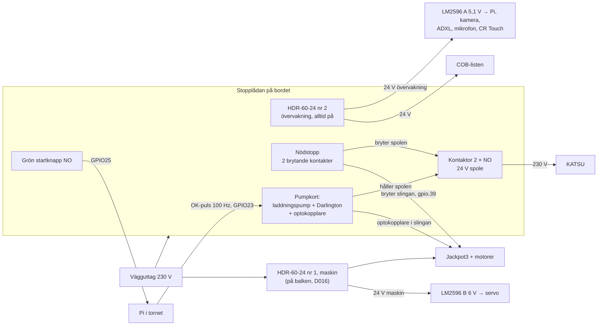

# El, belysning och övervakningsstopp — arbetsläge 2026-11-10

**Status:** Utrednings-/implementationsunderlag till **[låst D022: COB i stället för G4](../DECISIONS.md)**, inte ett separat konkurrerande komponentbeslut. **G4-lampor utgår och ska inte köpas eller CAD-projekteras.** Detta är ett planeringsunderlag, **inte** ett godkänt 230 V-kopplingsschema, en säkerhetsklassad stoppkrets eller en färdig CAD/montering. Elektrisk detaljprojektering och fysisk verifiering återstår. Låsta D013/D016/D020/D021/**D022** i `DECISIONS.md` gäller där de är relevanta. **Matning och stopp är valda 2026-11-10 i D023 (två matningsgrupper: maskin och övervakning) och D024 (kontaktor för KATSU, larmingång för Jackpot; ersätter NVR-brytaren i D013).** Där texten nedan säger NVR eller lämnar matningen öppen gäller D023/D024. Mjukvarans övervaknings- och stoppolicy ägs av [cnc/verktygsovervakning](https://github.com/kingkongola/cnc/blob/main/docs/verktygsovervakning.md).

## L1 2026-11-11: övervakningens nätdel, vald av användaren (D023)

**En andra Mean Well HDR-60-24** (24 V, 60 W, DIN, klass II), samma modell som maskinens. Den sitter i kontaktorlådan **före** nödstoppet och kontaktorn, så att den lever efter stopp (D023), och matar:

| Last | Effekt (uppgift, ej mätt) |
| --- | --- |
| BRIMETI COB, 3 × ca 0,8 m à 10 W/m | ca 24 W |
| Pi Zero 2 WH, kamera, ADXL, INMP441 via LM2596 A | ca 3 W |
| CR Touch | under 1 W |
| Kontaktorns 24 V-spole (D024) | ca 2 W, läses i databladet |
| **Summa** | **ca 30 W av 60 W** |

**Varför denna:** samma spänning som LED-listen och kontaktorspolen, så ingen extra regulator; samma montage och kapsling som redan finns i bygget; halv last ger marginal och svalt aggregat. Laptopladdaren (ca 20 V) räcker inte till 24 V-LED:en, och elsparkcykelladdarens utspänning är okänd. Föregående HDR-60-24 kostade enligt COSTS.md i en samlad DigiKey-order; aktuellt pris kontrolleras vid köp.

## Elschema: matning och stoppkedja (2026-11-11, förslag, ej provat)

Genomför D023 och D024. **Ingen 230 V-koppling görs efter detta dokument utan någon som är van vid nätspänning.** Komponentvärden är räknade, inte mätta; bänkprovet nedan avgör.

**Laddningspumpen (varför):** en GPIO-utgång som fastnar hög när Pi:n hänger sig skulle hålla KATSU igång. Pumpen drar spolen bara så länge Pi:ns program växlar utgången. Fast hög, fast låg, krasch, omstart, avbruten ledare och ström av på Pi:n ger alla samma sak: kontaktorn släpper och Jackpots larmslinga öppnas.

| Del på pumpkortet | Värde | Uppgift |
| --- | --- | --- |
| C1 | 10 µF keramisk/film | Släpper bara igenom växling; fast nivå blockeras |
| D1, D2 | 1N4148 | Likriktar pulserna till C2 |
| C2, R1 | 10 µF, 22 kΩ | Håller spänningen mellan pulserna; urladdas på ca 20–50 ms när pulserna slutar |
| R2, R3 | 2,2 kΩ till basen, 100 kΩ bas–jord | Basström; R3 håller transistorn av om ledaren går av |
| Q1 | BC517 (Darlington, 1 A) | Låg sida på spolen och optokopplarens lysdiod |
| D3 | 1N4007 över spolen, katod mot +24 V | Tar spolens spänningsspik när den släpper |
| R4 + U1 | 3,3 kΩ, PC817 | Lysdiod 24 V → R4 → U1 → Q1; U1:s transistor sluter Jackpots larmslinga |

**Spolkretsen:** +24 V övervakning → nödstoppets kontakt 1 → spolen → Q1 → jord. **Larmslingan:** Jackpot `gpio.39` → nödstoppets kontakt 2 → U1:s transistor → Jackpots jord. Sluten slinga = normal drift; öppen = larm (`estop_pin`). Pi:n börjar pulsa först efter tryck på den gröna knappen, och slutar vid sensorlarm; se `cnc/pi/sensorpi.py`.

**Säkringar:** F1 T2A (trög) på övervakningens 24 V ut från lådan till balken, F2 T1A på LED-grenen vid balken. HDR-60-24 har egen intern säkring och kortslutningsskydd. Vägguttaget ska sitta på en krets med jordfelsbrytare.

**Spänningsfall** (0,25 mm², räknat): LED-grenen 1 A över dubbla ledare i Y-kabeln ca 0,2 V; tornet ca 0,25 V jordförskjutning vid servots strömtopp. Allt inom marginal ([berakning_sidotorn.py](delar/sensorer/berakning_sidotorn.py)).

**Lådans layout (förslag):** plastkapsling med DIN-skena för 8–12 moduler, IP54 eller bättre. På skenan från vänster: kabelplint 230 V in, HDR-60-24 nr 2 (3 moduler), kontaktor (1 modul), säkringshållare F1 (1 modul), plint 24 V ut, pumpkortet på DIN-hållare (2 moduler). Nödstoppet och den gröna knappen i locket (22 mm hål). Stickpropp och KATSU-uttag via kabelförskruvningar. Lådan skruvas på bordets framkant så att nödstoppet nås utan att sträcka sig över maskinen. Plast, så att inga utsatta metalldelar behöver skyddsjord.

**Pumpkortet (hålkort, ca 30 × 40 mm):** C1 och D1/D2 vid ingången från Pi:n, C2/R1 bredvid, R2/R3 till Q1:s bas, Q1 i mitten, D3 över spolplintens två poler, R4 och PC817 vid larmslingans plint. Plintar: OK-puls, GND, +24 V, spole, larmslinga ×2.

**Felfall i 230 V-delen:**
| Fel | Följd | Skydd |
| --- | --- | --- |
| Kontaktorns kontakt svetsas fast | KATSU går trots stopp | Kontaktorn har 2 × NO: koppla båda i serie på fasen (eller bryt fas och nolla). En svetsad kontakt räcker då inte för att hålla KATSU igång. Prova vid varje uppstart: KATSU ska inte gå före grön knapp |
| Kortslutning i KATSU-kabeln | Kretsens säkring löser | Husets säkring; kabeln dras utanför rörliga delar |
| Jordfel | Risk för elchock | Jordfelsbrytare på kretsen; plastlåda |
| Nödstoppet går sönder öppet | Spolen och slingan bryts | Felsäkert: allt stannar |
| Nödstoppet går sönder slutet | Stopp bara via Pi och pump | Prova nödstoppet vid varje uppstart (CHECKLIST) |

**Kablar**

| Sträcka | Kabel | Ledare |
| --- | --- | --- |
| Lådan → balken (Y-kedjan) | LiYCY 8 × 0,25 mm² | +24 V övervakning ×2, jord ×2 (LED-strömmen ca 1 A), OK-puls, startknapp, larmslinga ×2 |
| Balken → tornet (X-vägen) | LiYCY 12 × 0,25 mm² | Se [kopplingsunderlaget](delar/sensorer/KOPPLING_CORE_V0.md) |
| HDR nr 1 | Som i dag (D016) | Ändras inte |

**Bänkprov av lådan före 230 V** (24 V-delen med kontaktorns spole, KATSU ej ansluten):
1. Ingen puls: kontaktorn ligger ute, slingan är öppen (mät med multimeter).
2. Puls 100 Hz från Pi:n eller ESP32:n: kontaktorn drar, slingan sluten.
3. Avbryt programmet, sätt utgången fast hög, sätt den fast låg, dra ur pulsledaren: kontaktorn släpper varje gång inom 0,2 s.
4. Tryck nödstoppet under puls: kontaktorn släpper och slingan öppnas.
5. Mät spolens ström och spänningen på C2; logga i CALIBRATION.md.

## Verifierat, valt och osäkert — blanda inte ihop

| Del | Fakta/status | Anmärkning |
| --- | --- | --- |
| Fräs | KATSU 101750, 220–240 V AC, 710 W; köpt | Egen nätlast, inget 24 V-tillbehör |
| Maskinmatning | Mean Well HDR-60-24, 24 V DC/2,5 A/**60 W**; köpt/mottaget | Till Jackpot3 + fem stegmotorer. Ingen reserverad LED-effekt kan antas utan mätning |
| LED | **BRIMETI COB, 5 m, 24 V, 4000 K, 8 mm, 320 LED/m, vald för 145 kr med Prime enligt användaren** | Angiven effekt **10 W/m**, angivet utbyte **100 lm/W**, dvs ungefär **1 000 lm/m**. Säljaruppgifter, ej uppmätta; CRI och faktisk stripbredd ska verifieras på den mottagna varan. Faktisk debitering och mottagning ej verifierade |
| Ursprunglig RGB-list | 12 V, ca 10 m, Tuya, 12 V/1 A-adapter | Vid maximalt rött mätte användaren 12,2 V vid matning och 8,6 V längst bort; stora längdförluster och otillräckligt arbetsljus. Inte vald till CNC |
| Altec Lansing | Äldre **17 V**-aggregat | Användaren har redan klippt kabeln; inte valt som CNC-försörjning |
| Laptopladdare | Användaren har en märkt ca **150 W**, misstänkt 20 V | Utspänning, effekt och kontakt måste läsas på exakt exemplar. Möjlig separat Pi-försörjning via 20→5,1 V, om verifierad |
| Elsparkcykelladdare | Användaren tror sig ha en laddare märkt "24 V" | Output ej känd. En 24 V nominell batteriladdare kan lämna högre spänning; inte vald innan etikett har kontrollerats |
| Regulatorer | **10 × LM2596** köpta enligt BOM | Buck/sänkande, **inte** boost; verklig termisk kontinuerlig kapacitet ska verifieras |
| Pi/kamera | Pi Zero 2 WH + Camera Module 3 Standard beställda | Pi behöver stabil reglerad ca 5,1 V med korrekt marginal; kameran matas via Pi |
| Servo/prob | Spektrum SPMS664 ca 6,0–7,4 V; BLTouch/CR Touch-prob avses 5 V | Exakt probvariant och 5 V-/signalkoppling ska identifieras. Servot ska ha egen 6 V-regulator och inte störa Pi |

## Geometriskt krav — tre COB-remsor, minsta rimliga Z-intrång

**Aktuellt konstruktionsprov 2026-11-10 (D022):** tre 8 mm BRIMETI COB-banor under den **horisontella understruten**: en rakt ned och två framåt, med vinklar **0°/15°/35°**. 35° ersätter 30° efter uttryckligt godkännande av användaren för cirka 6,6 mm nedstick. Detta är ännu ett **provisoriskt optiskt val**, inte en uppmätt ljusfördelning.

- **CAD:** [`delar/led/tre_vinklar.py`](delar/led/tre_vinklar.py), längsgående stag på de två vinklade hyllorna, 9 mm bredd som bär 8 mm LED med 0,5 mm sidomarginal, hylltjocklek 1,6 mm, överyta 0,9 mm och kantstag 1,2 mm.
- **Z-intrång för endast fästet:** 35° ger **6,62 mm teoretiskt max** under plattans undersida, som avrundas till cirka **6,6 mm**. Kodens **hårda tak 6,65 mm** ger liten numerisk marginal. LED-list/tejp, kablar/lödning och skruvar ingår **inte** och måste mätas vid provprint. Full maskinfrigång ännu ej verifierad.
- Befintliga två M5/Brace-positioner **56 mm c/c** i understruten och **160,2 mm** stationsdelning från `strut_plate.svg`; ingen ny mekanisk fästborrning. Kabelgenomföring kan bli nödvändig men placeras först efter kontroll av monteringen.
- **Ogiltig äldre CAD:** 90° felvänd strut, ~21 mm nedsänkt pelarkonstruktion samt äldre 0°/15°/25° och 0°/15°/30° som standardvinklar. Skriv inte ut äldre uppladdad STL/STEP. Det finns tidigare lokal CadQuery-kontroll **endast för 30°-varianten**; den är **inte ett testbevis för 35°**. build123d-CI och faktisk print återstår att verifiera.
- Ingen aluminiumprofil väljs före termisk provning av BRIMETI på tänkt fästyta. Kontrollera vidhäftning, temperatur, 35°-listens påverkan på 15°-listens ljus och skuggor från förstärkningsstagen.

## Monteringsbeslut i arbete — kabel och utformning (2026-11-10)

**Kablar:** Tre 24 V COB-remsor kopplas **parallellt**, varje remsa med lödda +24 V/GND-anslutningar och mekanisk avlastning. Förlägg en gemensam tvåledarmatning till balken. Använd **befintlig öppning eller plattkant om möjligt**; annars kan **en** kabelgenomföring borras i den horisontella understrutplattan. En annan LowRider-byggare verkar ha borrat hål, men syftet är inte verifierat. **Exakt hålposition/diameter är inte beslutade och inget har borrats**: gör torrmontering med M5/Brace och full XYZ-rörelse, markera fri plats, kontrollera båda sidor, avgrada/skydda och dragavlasta. Befintliga M5-låspunkter och bärande smala partier får inte försvagas. Dra LED-lågspänningen separat från 230 V. [Full kontroll- och kabelplan](delar/led/README.md#kabeldragning--monteringsplan-ännu-ej-borrad).

**Formgivning av CAD:** Lågprofilens 1,6 mm hyllor har rundade ändar (1,2 mm) och diskret långkantfas (0,2 mm), baswebbens hörn radie 0,7 mm och förstärkta M5-bossar radie 0,6 mm. **Z-budget 6,65 mm gäller för 35°-varianten, före estetiska detaljer.** Äldre 3 mm hel bas och långa pelare är supersederade. [Aktuellt CAD-underlag](delar/led/README.md).

## Kraftdomäner och stopp — principer, inte kopplingsorder

1. **Maskin:** befintlig Mean Well 24 V/60 W matar Jackpot3/stegmotorer; KATSU är separat 230 V-last. Fysiskt nåbar maskinstopp-/NVR-kedja med manuell återställning enligt D013 ska finnas och verifieras oberoende av Wi-Fi/Pi/smartrelä.
2. **Övervakning:** Pi/kamera ska vara **på en matning som ligger utanför maskinstoppets brytna gren**, så att den kan fortsätta observera, logga och signalera efter automatiskt/fysiskt stopp. Det äldre schemat `machine/delar/sensorer/KOPPLING_CORE_V0.md` visar Pi på maskinens 24 V och är **inte giltigt som matningsbeslut** för detta nya krav. Oberoende matning betyder inte batteribackup vid totalt nätavbrott.
3. **Automatisk extraskyddsfunktion:** användarens önskemål är att avvikelse från bild/ljud/vibration ska kunna leda till **automatisk frånkoppling av KATSU och maskin från huset**, exempelvis via Shelly som komplement till fysiskt maskinstopp. Varken reläval, elinstallation, motorlastdimensionering, bekräftad frånkoppling, watchdog/heartbeat, återställningssekvens eller sensorpolicyn är färdig. En Wi-Fi-/Pi-begäran får inte förväxlas med oberoende säkerhetsklassat nödstopp.
4. **LED:** matar man hela rullen blir den uppgivna lasten 50 W vid 24 V (ca 2,1 A). Om bara tre ca 0,8 m-längder används blir det cirka 24 W. Välj aggregat **efter faktisk klipplängd**. Testa återanvändning av elsparkcykel-/laptopmatning först efter utspänningsverifiering. **Inget extra aggregat eller boost är beslutat/köpt.**
5. **Servo/prob:** separata reglerade matningar med korrekt referens till Jackpot. Risk för oavsiktlig bakmatning från övervakningens matning till avstängd Jackpot/prob måste undersökas. Raspberry Pi får inte kopplas direkt till 24 V. Regulatorer, förgrening, säkringar, signaljord och stör/immunitetskrav dimensioneras och provas innan inkoppling.
6. **Stoppbeteende:** hård strömbrytning kan låta Z falla medan KATSU varvar ned. Mät och riskbedöm fall/eftergång; ingen automatisk återstart, och fräsbyte kräver fysisk frånkoppling. Sensorförlust och felstopp ska vara synliga för användaren. Fjärrövervakning gör inte obevakad fräsning säker i sig.

## Närmast återstående arbete

- Kontrollera faktisk Brimeti-bredd, originalets HORISONTELLA understrut, befintliga två M5/Brace-låsskruvar och grepp med **2,2 mm lokala bossar**; inget får sticka ned i den verkliga Z-kollisionszonen.
- **Lågprofil-CAD ersätter både 90°-fel och tidigare ~21 mm nedsänkta pelare.** Kontrollera build123d-export och CAD-Z-bounds **≤6,65 mm** i CI, provprinta **ett** mittfäste; därefter skruvar/kollision, verklig Z-frigång, belysnings-/kameratest och full XYZ-svep.
- Läs outputmärkning på befintlig 24 V-kandidat och 150 W-laddare; mät/bedöm effekt innan köp av boost/PSU.
- Specificera separat övervakningsmatning, två stoppvägar, förväntat stoppbeteende, kabelskydd och återstartsspärr. Samordna med `cnc/docs/verktygsovervakning.md`; ändra inte aktiv FluidNC.

**Öppet:** ingen elkoppling, CAD-vinkel eller inköpslista är genom detta dokument godkänd för drift.
