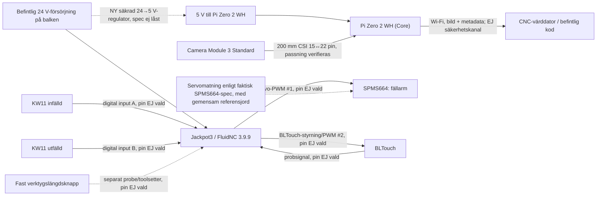

# Core-sensorer – elektrisk koppling v0, 2026-11-09

**Status: ritning för granskning före beställning/inkoppling, inte kopplingsorder.** Saknade kontakter, fysisk PCB-revision och verklig BLTouch-variant är uttryckligen okända. Pinnarna är valda i D021. Dokumentet ändrar **inte** `machine/AKTIV` eller FluidNC.

## Brytare utgår 2026-11-09

**Ersatt av [D020](../../../DECISIONS.md):** inga KW11 på armen, och de två brytarraderna och ingångarna nedan gäller inte längre. Texten nedan är historik.

## Brytare uppdaterade 2026-11-09

**Två nya QUARKZMAN KW11-3Z-N (rullspak, COM/NO/NC) är beställda för armen, beräknad leverans 2026-11-14.** Dina Omron SS-3GL13PT hålls i reserv för V1E:s befintliga maskin. Den elektriska principen är fortfarande två oberoende signalledningar till Jackpot och COM/NO mot verifierad pull-up. Inga GPIO valda. **Hårdstoppen är andra mekaniska delar än brytarna.** Kabeln ansluts med avlastning, i separata kanaler där möjligt; produktens annons säger inget säkert om IP-klass.

## Avsedd uppdelning



**Ingen elektrisk signal eller fysisk kabel är färdigprojekterad.** Pi-kameran går till Pi, **inte** direkt till Jackpot. Pi:s GPIO ska **inte** vara säkerhetsrelä för CNC eller ersätta Jackpot3:s hårdvaruprob. Kritiska maskinsignaler får inte styras via Wi-Fi.

## Signaltabell – välj inga pinnar av bekvämlighet

| Signal | Koppling | Nuvarande status | Blockerare |
|---|---|---|---|
| Kamera-CSI | Module 3 Standard → 200 mm 15/22 FFC → Zero 2 WH | Beställd, inte mottagen | Kontaktriktning, böjradie, dragavlastning |
| Pi-matning | Reglerad 5 V → Pi:s korrekta ingång | Planerad | 24→5 V-regulator, ström, säkring, EMC, fysisk jorddragning |
| Fällservo | Signal från 5 V-utgång + egen LM2596 på 6,0 V | `gpio.27`, D021, ej inkopplad | Bygel på 5 V, signalnivå mäts, pulslängder ställs vid provning |
| BLTouch-styrning | Signal från 5 V-utgång + 5,1 V/GND från LM2596 A | `gpio.26`, D021, ej inkopplad | Puls vid start är ofarlig här; exakt revision kontrolleras |
| BLTouch-signal | Probe-input | `gpio.36`, D021, ej inkopplad | Polaritet provas med `?` före G38, V3.1 är open drain som standard |
| Fällarm infälld/utfälld | 2 × KW11 SPDT som separata ingångar | `gpio.13/14` kandidater via expansionsport | Verifierad PCB-port, COM/NO, debounce, M66 och skydd |
| Fast verktygslängdsknapp | `toolsetter_pin` | `gpio.39`, D021, ej inkopplad | Knappens status okänd |
| ADXL345 | Till Pi lokalt via 3,3 V, SPI för hög samplingsfrekvens | Beställd. Används till processövervakning under fräsning, stillastående före bild och slag, se `cnc/docs/verktygsovervakning.md` | Verklig modul/spänningskrav |
| INMP441 (senare) | Digital I²S till lämplig mikrofonvärd | Inte del av v0 | Signal-/kabel- och störningsprov |
| Fläkt | **Ingen i v0** | Ej vald | Temperaturbevis först |

**Räknat utifrån dokumenterad aktiv config:** fem maskinändlägesingångar + `gpio.36` lämnar en dedikerad skyddad ingång (`gpio.39`) på Jackpot3. De två brytarsignalerna kan behöva modulporten, inte fler användningar av befintliga limit-pinnar. `gpio.12/15` är delade med RJ11; välj först efter verifierad revision och eventuell pendant. Servoutgång `gpio.27` är **kandidat**, inte godkänd PWM. Se [I/O-kartläggningen](../nollpunkt/JACKPOT3_IO.md).

## Konfigändring vid inkoppling (görs inte förrän delarna sitter)

```yaml
user_outputs:
  analog0_pin: gpio.27     # fällservo, flyttas från digital1
  analog1_pin: gpio.26     # BLTouch-styrning, flyttas från digital0
  analog0_hz: 50
  analog1_hz: 50
  digital0_pin: NO_PIN
  digital1_pin: NO_PIN
probe:
  toolsetter_pin: gpio.39
```

Styrs med `M67 E0 Q...` och `M67 E1 Q...` i procent av 20 ms. BLTouch: ut 650 µs (3,25 %), in 1475 µs (7,375 %), kontrolleras mot manualen för exakt revision.

## Kraft, säkerhet och kabeldragning

- **Servot:** egen LM2596 ställd till 6,0 V (SPMS664 är specat 6,0–7,4 V), skild från Pi:ns 5,1 V.
- **5 V till Pi:** specifik buck/regulator, säkring, ledningsarea och eventuell isolering ska dimensioneras efter uppmätt ström och EMC. Anslut **aldrig 24 V** till Pi-/kameramodulen. **Koppla inte Pi:s 5 V parallellt** med en okänd 5 V-regulator på Jackpot utan verifierad skyddskrets.
- **SPMS664:** servoströmspikar får inte sänka Pi:s matningsspänning eller orsaka återstarter av Jackpot. Korrekt gemensam signaljord/returledare krävs, men jordningsplan måste granskas innan plint ritas.
- **BLTouch:** enligt [ANTCLABS](https://www.antclabs.com/wiring) krävs separat styr-I/O, kontakt-/probe-I/O och 5 V/GND. Se till att utgångsnivå, pinout och fysisk probrevision stämmer. Monteras lodrätt under mätning enligt [tillverkaren](https://www.antclabs.com/bltouch-v3).
- **Två probe-ingångar:** FluidNC:s `probe.pin` och `toolsetter_pin` är **samma G38-triggerlogik**. `check_mode_start: true` ska avvisa redan aktiv probe, men skyddar inte mot kontakt från **fel** prob under rörelsen. Mät- och armsekvens måste förbli operatörsgodkänd.
- **CSI 200 mm:** placera Pi nära kameran, inte ute på fast bord. Skydda ribbon mot skarp vikning, dammsko, kabelkedjor och vibration; testa full X/Y/Z-svep vid avstängd fräs. Pi-kapslingen fästs först efter kontroll av servofällningen.
- **Fläkt:** Raspberry Pi kan hantera termisk throttling; stillbilder med beräkning på värddatorn talar för passiv kylning. Vår kapsling har små ventilationsöppningar men fläkt drar aktivt in spån och damm. Mät `vcgencmd measure_temp` under långvarigt verkligt kamerajobb. [Raspberry Pi:s kylguide](https://pip.raspberrypi.com/categories/685-app-notes-guides-whitepapers/documents/RP-003608-WP/Cooling-a-Raspberry-Pi-device.pdf).

**Nästa fysiska grind** (inte att göra före leverans): foto av verkligt Jackpot3-revisionsnummer och kontakter, provpassning med Servo/BLTouch och mätning av 5V/3,3V-signaler. **Ingen aktiv motorstyrning, ingen inkoppling och ingen ändring av `config.yaml` följer av detta dokument.**
